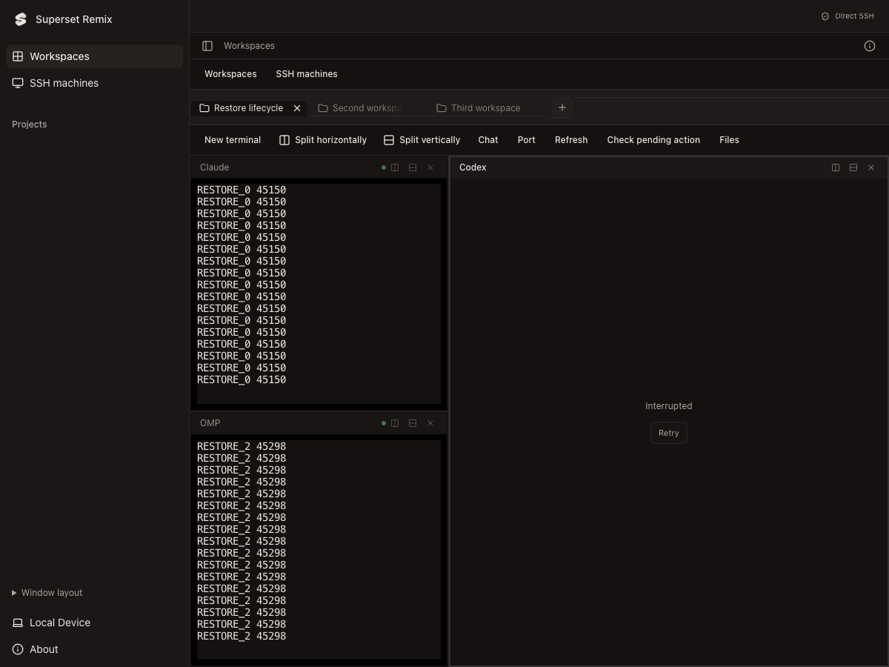

# Superset Remix

Local and SSH workstations. An unofficial modified version of [Superset](https://github.com/superset-sh/superset), independently maintained without endorsement from Superset, Inc.

[Downloads](https://github.com/4444zyf/superset/releases) · [Fork issues](https://github.com/4444zyf/superset/issues) · [Build guide](DEVELOPMENT.md)

## Use the desktop

The current desktop opens the accountless Workstation: add an SSH machine, connect, and install the bundled verified backend automatically when it is missing. Initial installation may require the remote administrator password. Terminals, projects and workspaces use the selected local or SSH backend; disconnecting the desktop leaves remote tasks running.

Verified 1.37.6 previews with the redesigned icon and upstream workspace layout: [Apple Silicon](https://github.com/4444zyf/superset/actions/runs/38406074334/artifacts/11819389283) · [Intel](https://github.com/4444zyf/superset/actions/runs/38406074334/artifacts/11821542454). Both native jobs passed in [the same workflow](https://github.com/4444zyf/superset/actions/runs/38406074334). Artifacts include checksums, source, SSH/UI acceptance and legal notices, and expire after 14 days. The packaged source is `5f57715ff03a6cb984c04cde0243d297872654ff`. Performance comparisons are recorded in [the implementation report](docs/implementation/ssh-performance-2026-10-13.md).

The 1.37.7 source adds project worktrees under `~/Superset Remix/worktrees/<project-name>-<project-id>/<branch>` on each running machine. Choose a project when creating a session; the upstream Worktree/Local picker selects an isolated worktree or the shared project checkout. The downloaded 1.37.6 previews above predate this change. See the [feature progress](docs/design/local-ssh-feature-parity.md).

macOS Apple Silicon and Intel preview DMGs are built and checked separately. Preview downloads may appear as workflow artifacts before a GitHub prerelease is published. Use the version and source checksum included with each artifact. Historical `Superset SSH Preview` downloads predate this branding. Linux and Windows distributions have not been validated for this fork.

This product starts with a new independent `superset-remix` data directory. It does not import the earlier preview or upstream application's data automatically. Update manually using this fork's downloads. Apple Developer ID signing and notarization are not configured; these are ad-hoc signed development previews.

Fork identity and modification details are documented here and in [FORK_NOTICE.md](FORK_NOTICE.md). The desktop has a normal **About** entry with the installed version, source links and original license available offline.

This screenshot is from the actual verified arm64 DMG, source `5f57715ff03a6cb984c04cde0243d297872654ff`. It shows the redesigned mark and reused upstream workspace components. Native screenshots and measurements accompany the build artifacts.

## Scope and attribution

Superset's website, hosted services, mobile app, subscription plans, and community remain upstream services. This fork does not publish or operate them. Source for those surfaces remains in the monorepo; see the [surface inventory and source audit](docs/design/branding-audit.md). Upstream documentation describes upstream features and may differ from this desktop.

Original authorship, copyright and [Elastic License 2.0](LICENSE.md) are preserved. See [FORK_NOTICE.md](FORK_NOTICE.md) for the modification notice, [CONTRIBUTING.md](CONTRIBUTING.md) for contributions, and [SECURITY.md](SECURITY.md) for reporting limitations.

## Translations

[cs](readme/README.cs.md) · [de](readme/README.de.md) · [es](readme/README.es.md) · [fr](readme/README.fr.md) · [id](readme/README.id.md) · [it](readme/README.it.md) · [ja](readme/README.ja.md) · [ko](readme/README.ko.md) · [nl](readme/README.nl.md) · [pl](readme/README.pl.md) · [pt-BR](readme/README.pt-BR.md) · [ru](readme/README.ru.md) · [tr](readme/README.tr.md) · [vi](readme/README.vi.md) · [zh-CN](readme/README.zh-CN.md) · [zh-TW](readme/README.zh-TW.md)
