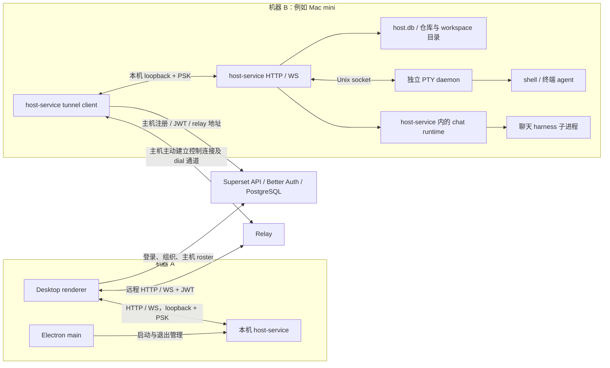

# Superset 账号、远程主机与会话运行现状

- 仓库：`4444zyf/superset`，本次读取的 `main` 检出。
- 源码基线：`4ec5b6e287d380480a71b4b2ad98976354c82d4f`。
- 梳理日期：2026-10-10。
- 方法：使用 `git show 4ec5b6e287d380480a71b4b2ad98976354c82d4f:<path>` 阅读基线源码，并阅读相关现有测试；下方 75 个源码链接固定到上述提交，已核对文件存在、行号范围及引用完整性。
- 工作区边界：重试时工作区已有未提交的实现和设计文档。本文不将这些内容视为 `main` 的已有能力；已有文件与改动均保留，本次没有继续实施改造。
- 工作范围：记录现状及证据，不提出改造设计、不修改应用代码。本次没有运行 Electron、连接真实 Mac mini 或执行 SSH 端到端测试。

## 1. 本次关注的使用场景

用户希望在机器 A 的 Superset 桌面应用里，选择通过 SSH 连接的远程 Mac mini，在远端添加代码项目、创建会话并运行 agent；随后退出机器 A 上的应用，远端 agent 仍继续运行。同时希望移除 Superset 的账号体系。

这里的“账号体系”按 Superset 自身的用户、登录会话、组织及成员权限理解。Git/SSH 凭据、Claude/Codex 等 agent 的服务账号是源码中的其他概念，本文分别记录，不将它们混同。

当前代码的主要事实：

1. 桌面主要工作区要求 Superset 登录会话和活动组织；账号还参与本机 host-service 启动、远端主机发现及访问授权。
2. 用户主机已有“本机直连、其他机器经 relay”的运行路径；本次检索未发现通过 SSH 添加/连接用户主机的已实现路径。
3. v2 代码项目、workspace、终端记录主要由执行主机上的 SQLite 保存。远程执行已经存在，但连接与主机发现仍依赖 Superset API 和 relay。
4. 客户端连接断开不会直接杀死终端 PTY，也不会直接取消聊天任务。终端 agent 与聊天 agent 的执行进程归属不同，必须分别判断。
5. 生产模式已有独立 PTY daemon，以及 CLI 启动后台 host-service 的能力；这两项能力与“通过 SSH 连接主机”是不同事实。

## 2. 术语与源码范围

| 名称 | 当前代码中的含义 |
| --- | --- |
| Desktop | 机器 A 上的 Electron 主进程及 React renderer；展示 UI、保存客户端状态、管理自己启动的本机服务。 |
| host-service | 执行机器上的 HTTP/WebSocket 服务；管理仓库、workspace、文件/Git 操作、终端接口及聊天 runtime。 |
| 代码项目 | host-service 的 `projects` 表记录：仓库路径、远程 Git 地址、名称和项目设置。 |
| workspace | 执行目录及元数据；类型包括 `local`、`worktree`、`session`。 |
| project-less session | `projectId = null` 的 workspace，拥有独立目录和 Git 仓库；对应此次关注的独立“会话”入口。 |
| terminal session / PTY | workspace 内的一次 shell/终端进程；实际 PTY 由独立 daemon 持有。 |
| chat session | 内置聊天 runtime 管理的 agent 会话；历史写入 `chat.db`，实时执行由 host-service 中的 runtime 管理。 |
| relay | 服务端转发通道；将客户端 HTTP/WebSocket 流量转送到主机主动建立的 tunnel。 |

依据：[本地项目表][local-project-schema]、[workspace 表][local-workspace-schema]、[终端与 agent 绑定表][local-schema]、[聊天挂载][chat-mount]。

仓库仍有 v1 桌面本地路由和旧 terminal-host，以及独立 cloud sandbox 路径。本文重点沿 v2 用户主机的调用链梳理；`useIsV2CloudEnabled` 会依据用户、迁移状态和本机设置选择界面，不能假设所有现有安装都走同一分支。[版本分支][feature-v2]

另一个容易混淆的入口是 dashboard 的 `NewProjectDialog`：它描述的是“group tasks and cloud workspaces”的任务项目，和本文的代码仓库项目不是同一个对象。[任务项目弹窗][task-project-ui]

## 3. 当前组件与连接关系

下图是已有用户主机路径；远程 Mac mini 在图中记为机器 B。机器 B 必须已运行 host-service。

依据：[地址选择][resolve-host]、[注册与连接 relay][connect-relay]、[WS 转发][tunnel-client]、[HTTP 转发][tunnel-http]、[PTY daemon 启动][daemon-spawn]、[聊天 runtime][chat-dispose]。

图中的 relay 转发实际承载远端操作和流式数据，并非仅用于发现主机。本次读取的连接链里没有 SSH 通道。

## 4. Superset 账号体系的现有依赖

### 4.1 登录与界面准入

- Electron 的 `auth.signIn` 打开 API 的 `/api/auth/desktop/connect`，由浏览器完成 OAuth；macOS 使用 deep link 回传，Linux 有 localhost callback 分支。[登录入口][auth-router]
- Superset 服务端使用 Better Auth 和 Drizzle 数据库适配器；源码配置了 GitHub、Google、Apple 登录及组织、JWT、API key、订阅等插件。[服务端认证][auth-server]、[登录 provider][auth-social]
- 登录 token 保存为 Superset home 下的 `auth-token.enc`，还保存组织成员快照和版本；renderer 的 `AuthProvider` 从主进程加载 token，再恢复会话和 JWT。[token 存储][token-storage]、[认证初始化][auth-provider]
- authenticated layout 用 `session.user` 判断登录，用活动组织判断是否进入组织创建页；未登录跳转 sign-in，未完成 onboarding 另有准入条件。[准入判断][auth-layout]
- 有本地 token、但无法恢复用户会话且处于离线状态时，layout 会显示离线界面。本地执行服务的离线能力不能据此等同于一个完整的匿名离线桌面模式。[离线判断][auth-layout]

`SKIP_ENV_VALIDATION` 在相关组件中使用 mock 登录/组织值，但当前源码没有把它定义为面向用户的“无账号模式”。

### 4.2 账号、组织与执行服务的耦合

| 位置 | 现有依赖 | 证据 |
| --- | --- | --- |
| 云 API | `protectedProcedure` 要求 session；组织 header 与活动组织参与成员校验。另有 JWT procedure 提供用户及组织上下文。 | [session 中间件][cloud-auth]、[JWT 中间件][jwt-procedure] |
| JWT | 服务端签发包含 `sub = user.id`、`organizationIds` 的 JWT；Better Auth JWT 插件配置有效期 1 小时，桌面有刷新与缓存逻辑。 | [JWT payload][jwt-payload]、[桌面 JWT][auth-client] |
| 本机服务启动 | 主进程从已存 token 和组织成员列表 reconcile 本机 host-service；缺少任一项就不在此流程启动服务。token 更换或清除会触发 `stopAll()`。 | [本机启动与账号事件][host-bootstrap] |
| 主机身份 | 云端 `v2_hosts` 以 `organizationId + machineId` 为主键；`v2_users_hosts` 保存用户与主机之间的 owner/member 关系。 | [主机数据库模型][host-schema] |
| 主机列表 | roster 校验当前用户的组织成员资格，并联表筛选该用户有权限的主机。 | [roster 与成员查询][host-roster] |
| 创建会话 | 桌面提交要求活动组织；workspace 写入 `createdByUserId`，标签等主机数据也保留用户归属。 | [提交入口][workspace-submit]、[创建 session][create-session] |
| 本机存储隔离 | CLI 的 host manifest 与 `host.db` 位于 Superset home 的 `host/<organizationId>/`；本机服务按组织管理。 | [存储路径][host-db-path]、[本机服务管理][coordinator-stop] |
| 远程服务出站认证 | host-service 使用账号 token 获取/提供 JWT，调用 API 并连接 relay。 | [API auth provider][host-api-auth]、[relay 初始化][connect-relay] |
| 登出 | Electron 的 sign-out 先停止自身管理的本机服务，再清除 token。 | [登出][auth-router] |

因此，当前“账号体系”涉及界面、主机名册、权限、出站认证、服务启动和数据归属多个层面；代码项目本地存储已经成立，但整条使用链仍含账号依赖。

订阅也在账号服务中存在。`host.checkAccess` 返回 `allowed` 和 `paidPlan`：前者在该函数里依据主机成员关系，后者另算订阅状态。不能仅看到订阅查询就断言主机访问必须付费。[访问判断][host-access]

### 4.3 Superset 身份与主机连接认证是两层

本机 HTTP 请求向 host-service 提供预共享密钥（PSK）；远程请求先向 relay 提供 Superset JWT。relay 校验用户后覆盖 `x-superset-user-id`，主机 tunnel 再以 PSK 转发到自己机器上的 loopback 服务。host-service 的 protected procedure 校验主机认证，不直接对每个请求再次执行 Superset OAuth 登录。

证据：[客户端 headers][host-headers]、[用户身份转发规则][host-routing]、[主机 PSK 校验][host-psk]、[tunnel HTTP 转发][tunnel-http]。

主机运行 agent 仍需执行机器上相应 CLI、服务凭据和 Git 凭据。它们与 Superset 的用户登录 token 用途不同；本次没有读取真实凭据或验证远端 CLI 环境。

## 5. 主机发现与远程访问现状

### 5.1 用户主机从哪里来

1. host-service 启动后通过 `api.host.ensure` 注册组织、machineId、名称、版本、平台和安装来源。
2. 注册成功后读取 API 给出的 relay endpoint，创建 tunnel client；认证用 host-service 的 JWT provider。
3. Desktop 的 `useKnownHosts` 从云端 roster 取名册，再通过各主机的 relay event socket 判断在线状态。
4. 创建 workspace 的设备选项再按活动组织、当前用户和主机成员关系筛选其他主机。

证据：[注册与 tunnel][connect-relay]、[主机注册 API][host-access]、[known hosts][known-hosts]、[设备选项][device-options]。

这里的 `isOnline` 是“可通过 relay 到达”，包括名册里的本机。它并不表示 SSH 可连接；设备选项也不是从 SSH config、主机名或 IP 地址读取而来。

### 5.2 地址与传输

| 目标 | 当前地址选择 |
| --- | --- |
| 当前机器 | 使用本机 host-service 的 activeHostUrl，通常为 `http://127.0.0.1:<port>`。 |
| 其他用户主机 | `<relayUrl>/hosts/<organizationId>:<machineId>`。 |
| Cloud sandbox | 地址解析器有单独 sandboxUrl 分支；`CLOUD_HOST_ID` 不作为普通用户主机解析。 |

[地址解析][resolve-host]直接体现这几个分支，没有 SSH 分支。CLI 的本机/远程目标解析也分别使用 manifest 的 loopback 地址和 relay 地址。[CLI 目标解析][cli-target]

远程请求的实际流程：

1. Desktop 根据选中的 machineId 和组织生成 relay 地址，HTTP/WS 使用 JWT。
2. Relay 验证 JWT、组织及主机访问权限；访问检查涉及 API 的主机成员表。
3. 远端 host-service 的 tunnel client 接到 dial 请求，将 HTTP 或 WS 接到该机器的 loopback 服务，并替换为本机 PSK 认证。
4. 终端连接、主机事件和聊天 stream 走相应 WS；项目/workspace 管理走 host-service tRPC。

证据：[relay 权限][relay-access]、[relay 路由][relay-entry]、[WS dial][tunnel-client]、[HTTP forwarding][tunnel-http]。

### 5.3 目前代码中出现的 SSH

本次检索 Desktop、host-service、host-client、workspace-client、CLI、relay 的源码，并在 apps/packages 的 TS、TSX 和包声明中补查 SSH 客户端、命令调用及配置关键词：

| 命中类型 | 当前用途 |
| --- | --- |
| Git 的 SSH URL | 克隆/解析 Git 仓库地址，例如 `git@github.com:...` 或 `ssh://...`；不是 Superset 主机连接。 |
| SSH agent 环境 | 保留 shell 的 SSH 相关变量，支持 Git push 等操作。 |
| 从 SSH 终端运行 CLI | 浏览器打开或剪贴板处理考虑远程终端场景；并未让 Desktop 经 SSH 访问 host-service。 |
| 注释中的 SSH | WorkspaceRuntime 和 ForwardTransport 的注释将 SSH 列为未来可能的实现；当前注释本身不代表已有实现。 |

证据：[Git 地址处理][ssh-git-url]、[SSH 环境保留][ssh-git-env]、[SSH 剪贴板场景][ssh-clipboard]、[runtime 注释][ssh-runtime-comment]、[端口转发注释][ssh-forward-comment]。

在上述范围内，未发现 SSH 主机配置模型、SSH 连接管理器或将 workspace 请求切到 SSH transport 的实现；包声明/锁文件检索也未发现 `ssh2`、`node-ssh`。这个结论结合实际地址解析与转发调用链得出，不仅依据关键词缺失。

手动在一个 shell 里执行 `ssh` 可以进入远端，但那属于 shell 中的命令，不能据此推导 Superset 会把远端识别为可添加项目/会话的 host。

## 6. 添加代码项目、创建 workspace 和启动 agent

### 6.1 添加代码项目

host-service 的 `project.create` 支持 `empty`、`clone`、`importLocal`、`template`。路径都在接到请求的 host 上解释和操作；项目 UUID、repoPath 和元数据写入该 host 的 SQLite，随后广播 project 变化。创建项目不会自动创建 workspace。[项目 API][project-create]、[创建 handler][project-handler]、[项目持久化][persist-project]

已经读取的桌面新建代码项目入口仍使用本机服务：

- 空项目弹窗等待 `useLocalHostService().waitForHostReady()`，调用本机 `project.create`。
- clone 弹窗使用 `useLocalHostService().activeHostUrl`，目录浏览器来自 Electron 的 `window.selectDirectory`。

证据：[空项目入口][empty-project-ui]、[clone 入口][clone-project-ui]。这些入口没有 SSH 主机输入，也没有将本机目录选择器变成远端目录浏览器。

另外，现有 `SetupProjectModal` 接收目标 hostUrl，能为已有 projectId 在另一主机 clone/import 仓库，并将 origin 的仓库坐标传给 `project.setup`。这说明代码里已有“在其他主机配置项目仓库”的能力，其主机访问仍走上一节的 relay 路径。[远端项目配置][setup-project-ui]

### 6.2 创建独立 session

创建 UI 选出的 hostId 交给 `useWorkspaceCreates.submit`。它依赖活动组织解析 hostUrl；`projectId = null` 时调用所选主机的 `workspaces.createSession`。[桌面提交][workspace-submit]

host 上的 `createSession`：

1. 分配独立目录，在该机器的 `~/.superset/sessions/<folder>` 下初始化 Git 仓库。
2. 插入 workspace：`projectId: null`、`type: "session"`、`branch: "main"`，记录执行目录及创建者。
3. 如带 agents，调用 agent launch；如带 command，创建命令终端；返回 workspace、terminals 和 agents。

证据：[session 创建][create-session]、[session 目录][session-path]。因此，若目标是当前已经通过 relay 注册的 Mac mini，目录、仓库和运行进程落在 Mac mini 上，机器 A 是调用方与显示端。

### 6.3 项目 workspace

有 projectId 的创建通常使用 `createEnqueued` / `createLocalEnqueued`：先返回 workspaceId，host-service 在后台执行实际 create，并广播 `workspace:create-settled`。旧主机缺少 enqueue 接口时，Desktop 有同步调用的兼容分支。[客户端创建流程][workspace-submit]、[host 后台创建][create-enqueued]

这是 host-service 内的后台 Promise；源码没有在这一实现中建立独立的持久任务队列。客户端断连、host-service 进程退出和机器重启是不同事件，不能把“请求已入队”解释成“进程退出也保证完成”。

### 6.4 agent 在哪里启动

`runAgentInWorkspace` 查询目标 host 的 workspace，得到执行目录，再选择聊天 launch 或终端 launch。[运行入口][agent-surface]

| 运行方式 | 当前执行链 |
| --- | --- |
| terminal | 构造 agent CLI 命令，以 `initialCommand` 调用 `createTerminalSessionInternal`；shell/agent 的 PTY 由该主机 daemon 持有。 |
| chat | 创建 host-service 的 chat runtime session，通过 harness 启动/驱动 agent。某些参数或不支持的 agent 会回退到 terminal。 |

证据：[终端 launch][agent-launch]、[运行入口][agent-surface]。

创建界面还会根据 agent 是否支持 ACP 及聊天开关决定 `surface`。因此，不能仅凭“创建了一个会话”就认定 agent 运行在独立 PTY daemon 里。[UI surface 选择][submit-surface]

项目与 workspace 列表则由各主机的接口和事件汇总；读取路径有本机直连、远端 relay 及客户端缓存，远端的旧列表可在离线时继续显示。缓存中的一行不证明对应进程现在仍运行。[workspace 读取][workspace-read]

## 7. 状态和进程的归属

| 状态/资源 | 当前归属 | 与机器 A 退出的关系 |
| --- | --- | --- |
| Superset 用户、组织、主机名册与访问关系 | 云端 PostgreSQL / API | 账号与远端发现/授权依赖；不是 agent 实际执行进程的宿主。 |
| 仓库和 workspace 文件 | 执行主机的文件系统 | 远端执行时位于机器 B。 |
| 代码项目、workspace、终端记录、agent 绑定 | 执行主机的 `host.db` | 不随机器 A 的 UI 进程退出而删除。 |
| 活跃 PTY 与 shell/终端 agent | 执行主机的独立 PTY daemon | 生命周期独立于单个客户端 WS；生产模式也独立于 host-service 重启。 |
| PTY replay buffer | daemon 内存，默认 64 KiB | 用于重连回放；daemon 死亡后不能靠这份内存恢复。 |
| chat 历史与 journal | 执行主机的 `chat.db` | 可以保留历史；持久历史不等于实时 agent 进程持续存在。 |
| chat live session 与 harness | 执行主机 host-service runtime | 客户端订阅可以离开；host-service 自身停止会失去该运行期。 |
| Desktop 的视图/布局/缓存 | 客户端侧状态 | 与 host 上的实际执行资源有不同生命周期。 |

证据：[本地终端与绑定表][local-schema]、[本地项目表][local-project-schema]、[本地 workspace 表][local-workspace-schema]、[无云端 workspace mirror 的当前存储路径][local-workspace-store]、[PTY 内存 buffer][daemon-buffer]、[聊天存储与 runtime][chat-dispose]。

云端仍保留旧 workspace 数据模型及其他 cloud/task 功能的数据；不能因为存在同名旧表，就把它当作当前 v2 用户主机 workspace 的权威存储。

## 8. 断连、关窗、退出与停止的区别

### 8.1 客户端连接断开

**终端：** host-service 的终端 WS `onClose/onError` 只调用 `detachSocket`。daemon 的 Unix socket 断开也仅移除客户端连接，session 仍由 daemon 保存。[终端断连][terminal-disconnect]、[daemon 断连][daemon-disconnect]

显式关闭 terminal session 才进入 daemon 的 `handleClose`，默认发 SIGHUP。reaper 处理已请求销毁、无所属 workspace 等终端；其判断不以“目前没有 UI 连接”作为销毁条件。[显式关闭][daemon-close]、[reaper 条件][terminal-reaper]

**聊天：** chat stream 的 WS 关闭/错误只调用 subscription.unsubscribe，没有调用 cancel 或 runtime.dispose。[chat stream 断连][chat-stream]。所以在 host-service 持续运行的前提下，关闭机器 A 的连接不会由该处理器直接中断正在执行的 turn；需要人类审批/补充输入的任务仍可能停在等待状态。

### 8.2 桌面应用与其本机服务

| 动作 | 当前代码行为 |
| --- | --- |
| macOS 关闭所有窗口 | `window-all-closed` 直接返回，Electron 继续运行；关窗不等于退出应用。 |
| 非 macOS 关闭最后一个窗口 | 触发 `app.quit()`。 |
| 普通退出 Desktop | `runQuitCleanup` 先停止 coordinator 管理的本机服务；只对自己拥有的子进程发 SIGTERM，对 adopted 实例只释放本地引用。 |
| 生产模式普通退出 | 不进入 `stopPtyDaemons` 的完全清理分支；v2 PTY daemon 以 detached + unref 运行，已有 PTY 保留。 |
| “Quit Completely” | 额外清理本机旧 terminal-host 和可回收 PTY daemons；仍在被其他本机 host-service 使用的 daemon 会跳过。 |
| 开发模式 | 有额外清理路径；standalone host-service 的 dev 信号处理会停止 daemon，不能用 dev 行为替代生产结论。 |
| Desktop 崩溃/父进程消失 | 由 Desktop 启动的本机 host-service 设置 HOST_PARENT_PID，watchdog 检测父进程死亡并关闭该服务。 |
| Superset 登出/账号 token 变化 | 清理自己管理的本机 host-service；不能等同于只隐藏登录界面。 |

证据：[窗口和退出事件][desktop-quit]、[退出清理分支][quit-sequence]、[owned/adopted 处理][coordinator-stop]、[daemon 生产启动方式][daemon-spawn]、[完全退出清理][stop-daemons]、[父进程 watchdog][desktop-host-entry]、[standalone dev 分支][standalone-entry]、[账号事件][host-bootstrap]。

这些清理针对机器 A 的本机资源。已读取的普通退出调用链没有向机器 B 发出远端 terminal kill 或 host-service stop 请求。

### 8.3 host-service 停止与 agent 持续运行

终端 PTY 在独立 daemon 中；生产模式的 host-service 重启可以重新连接 daemon。daemon 本身死亡、被完全清理、终端被显式关闭或机器重启时，不能把 SQLite 的 session/agent 绑定记录当成仍活着的进程。

chat runtime 则属于 host-service。`createApp.dispose` 会调用 `chatV3.dispose`，继而 dispose 所有 live sessions 和 harness；Codex stdio 子进程的关闭流程会结束输入，超时后 SIGKILL。[host dispose][host-dispose]、[chat dispose][chat-dispose]、[live session dispose][live-dispose]、[Codex 子进程][codex-child]

因此，生产模式普通退出“执行主机自己的 Desktop”可能保留终端 agent，但不能对内置聊天 agent 作相同的持续运行承诺。聊天 journal 的持久化和实时进程的持续运行是两个不同事实。

### 8.4 已有独立后台 host-service

CLI 有 `superset start --daemon`；代码会选择组织并将登录凭据传入 host-service，使用 detached 启动、日志文件 stdio 和 unref。它不需要靠一个始终打开的 Desktop 托管，但当前启动、注册和远程访问仍使用 Superset 账号/API/relay。[CLI start][cli-start]、[后台 spawn][cli-spawn]、[standalone auth 与服务][standalone-entry]

这属于现有能力说明；本次没有在 Mac mini 上执行该命令，也没有将它改造成 SSH 连接流程。

## 9. 对机器 A → Mac mini 场景的现状判断

| 用户关心的事项 | 当前实现与边界 |
| --- | --- |
| 不登录 Superset，直接进入完整工作区 | 主路径仍有登录与组织准入；本次没有发现完整的产品化无账号流程。 |
| 输入 Mac mini 的 SSH 地址、用户和密钥来添加主机 | 已读取主机模型、设备选择、地址解析与传输链未实现此入口。 |
| 在其他机器创建独立会话并运行 agent | 当前 v2 路径已有，前提是目标 host-service 已注册、用户有访问权限且 relay 可达。 |
| 在远端准备项目仓库 | 现有 project.setup 支持对已选远端 clone/import；已读新建代码项目弹窗主要绑定本机服务。 |
| 机器 A 普通退出后远端 agent 继续 | 从源码看，A 退出移除客户端连接并清理 A 的本机服务，没有直接销毁 B 的会话；B 的 host-service/daemon 必须保持运行，且不能执行显式会话关闭。 |
| Mac mini 上 Desktop 也退出 | 若 B 的 host-service 由其 Desktop 拥有，会被停止；生产模式终端 PTY 可能继续存在，但远端访问入口不再由这个 host-service 提供，聊天 runtime 也不具有同样的 daemon 持续运行机制。 |
| 全链路不经过 relay | 当前其他用户主机的 HTTP/WS 仍由 relay 承载；不能仅通过 Git SSH URL 或后台 daemon 得到这个行为。 |
| 后续重连看到同一任务 | 活跃终端可重连到 daemon、聊天历史可回放；daemon/host 实际生存状态、任务等待输入及有限 replay buffer 都影响结果。未对真实两机流程作运行证明。 |

上表只比较现有实现与目标场景，不包含技术选型、拆分方案、迁移步骤或代码修改计划。

## 10. 证据限制

本次完成了账号 → 主机发现/权限 → 地址与 relay → 项目/workspace 创建 → agent launch → 断连/退出的静态调用链阅读，并检索了 SSH 的现有使用位置。

重试时执行了现有 [退出分支测试][quit-test]：`bun test apps/desktop/src/main/lib/quit-sequence.test.ts`，结果为 **8 项通过、0 项失败**。该测试及其 `quit-sequence.ts` 实现没有工作区改动，测试覆盖普通退出保留 PTY daemon、完全退出触发额外清理等分支；使用注入的依赖，不是实际启动 Electron 的验证。已有 [PTY detach/reattach 集成测试][control-plane-test] 仍仅作阅读入口，本次未运行。

尚无本次运行证据的事项包括：真实 Mac mini 的 CLI/凭据可用性、A 普通退出后 B 的进程实际存活与持续输出、长时间断连后的重新 attach、生产应用重启和不同 agent/chat harness 的恢复表现。本文的“持续运行”结论只说明相关源码处理器与进程边界，不构成上述端到端场景已经验证通过的声明。

## 11. 云环境重试记录

按照 `cloud-environment-onboarding:setup` 检查了已有配置与外部准备目录 `/workspace/.cloud-onboarding/superset`，没有重新安装依赖或改写配置草稿。工具版本为 Bun 1.4.2、Node v24.19.0；源码阅读及上述已有测试可以执行。

执行已有 `start.sh` 后，本地 PostgreSQL、Neon HTTP proxy、Redis 和 Redis HTTP shim 的启动检查通过；实际 `SELECT 1`、Redis `PING`、已有数据库迁移和开发账号种子检查通过。随后严格 Lingui 编译因工作区已有 catalogs 中的无 context `Start` 文案缺少非英语翻译而失败，脚本未进入 Web/API 启动步骤。启动前独立应用 smoke 请求也因 API 3001 尚未监听而失败。

因此，本次不能声称完整应用环境启动或应用 smoke 已通过。这个阻塞不影响基线代码梳理；遵照本次不修改代码的范围，没有补翻译、修复已有实现或把失败检查改成通过。现有配置的保存不等同于发布环境，本次未发布。

[auth-layout]: https://github.com/4444zyf/superset/blob/4ec5b6e287d380480a71b4b2ad98976354c82d4f/apps/desktop/src/renderer/routes/_authenticated/layout.tsx#L106-L299
[auth-provider]: https://github.com/4444zyf/superset/blob/4ec5b6e287d380480a71b4b2ad98976354c82d4f/apps/desktop/src/renderer/providers/AuthProvider/AuthProvider.tsx#L17-L125
[auth-client]: https://github.com/4444zyf/superset/blob/4ec5b6e287d380480a71b4b2ad98976354c82d4f/apps/desktop/src/renderer/lib/auth-client.ts#L45-L156
[auth-router]: https://github.com/4444zyf/superset/blob/4ec5b6e287d380480a71b4b2ad98976354c82d4f/apps/desktop/src/lib/trpc/routers/auth/index.ts#L82-L127
[token-storage]: https://github.com/4444zyf/superset/blob/4ec5b6e287d380480a71b4b2ad98976354c82d4f/apps/desktop/src/lib/trpc/routers/auth/utils/auth-functions.ts#L14-L45
[auth-server]: https://github.com/4444zyf/superset/blob/4ec5b6e287d380480a71b4b2ad98976354c82d4f/packages/auth/src/server.ts
[auth-social]: https://github.com/4444zyf/superset/blob/4ec5b6e287d380480a71b4b2ad98976354c82d4f/packages/auth/src/server.ts#L294-L310
[jwt-procedure]: https://github.com/4444zyf/superset/blob/4ec5b6e287d380480a71b4b2ad98976354c82d4f/packages/trpc/src/trpc.ts#L248-L325
[jwt-payload]: https://github.com/4444zyf/superset/blob/4ec5b6e287d380480a71b4b2ad98976354c82d4f/packages/auth/src/server.ts#L434-L465
[cloud-auth]: https://github.com/4444zyf/superset/blob/4ec5b6e287d380480a71b4b2ad98976354c82d4f/packages/trpc/src/trpc.ts#L148-L193
[host-bootstrap]: https://github.com/4444zyf/superset/blob/4ec5b6e287d380480a71b4b2ad98976354c82d4f/apps/desktop/src/main/index.ts#L555-L599
[host-db-path]: https://github.com/4444zyf/superset/blob/4ec5b6e287d380480a71b4b2ad98976354c82d4f/packages/cli/src/lib/host/manifest.ts#L25-L87
[host-schema]: https://github.com/4444zyf/superset/blob/4ec5b6e287d380480a71b4b2ad98976354c82d4f/packages/db/src/schema/schema.ts#L1264-L1364
[host-roster]: https://github.com/4444zyf/superset/blob/4ec5b6e287d380480a71b4b2ad98976354c82d4f/packages/trpc/src/router/host/management.ts#L76-L126
[known-hosts]: https://github.com/4444zyf/superset/blob/4ec5b6e287d380480a71b4b2ad98976354c82d4f/apps/desktop/src/renderer/hooks/known-hosts/useKnownHosts/useKnownHosts.ts#L15-L106
[device-options]: https://github.com/4444zyf/superset/blob/4ec5b6e287d380480a71b4b2ad98976354c82d4f/apps/desktop/src/renderer/routes/_authenticated/components/DashboardNewWorkspaceModal/components/DashboardNewWorkspaceForm/components/DevicePicker/hooks/useWorkspaceHostOptions/useWorkspaceHostOptions.ts#L36-L104
[resolve-host]: https://github.com/4444zyf/superset/blob/4ec5b6e287d380480a71b4b2ad98976354c82d4f/apps/desktop/src/renderer/hooks/host-service/useHostTargetUrl/resolveHostUrl.ts#L1-L35
[host-headers]: https://github.com/4444zyf/superset/blob/4ec5b6e287d380480a71b4b2ad98976354c82d4f/apps/desktop/src/renderer/lib/host-service-auth.ts#L39-L61
[host-routing]: https://github.com/4444zyf/superset/blob/4ec5b6e287d380480a71b4b2ad98976354c82d4f/packages/shared/src/host-routing.ts#L9-L55
[relay-access]: https://github.com/4444zyf/superset/blob/4ec5b6e287d380480a71b4b2ad98976354c82d4f/apps/relay/src/access.ts#L47-L88
[relay-entry]: https://github.com/4444zyf/superset/blob/4ec5b6e287d380480a71b4b2ad98976354c82d4f/apps/relay/src/index.ts#L245-L376
[host-access]: https://github.com/4444zyf/superset/blob/4ec5b6e287d380480a71b4b2ad98976354c82d4f/packages/trpc/src/router/host/host.ts#L158-L277
[connect-relay]: https://github.com/4444zyf/superset/blob/4ec5b6e287d380480a71b4b2ad98976354c82d4f/packages/host-service/src/tunnel/connect.ts#L50-L109
[tunnel-client]: https://github.com/4444zyf/superset/blob/4ec5b6e287d380480a71b4b2ad98976354c82d4f/packages/host-service/src/tunnel/tunnel-client.ts#L217-L237
[tunnel-http]: https://github.com/4444zyf/superset/blob/4ec5b6e287d380480a71b4b2ad98976354c82d4f/packages/host-service/src/tunnel/tunnel-client.ts#L358-L367
[host-psk]: https://github.com/4444zyf/superset/blob/4ec5b6e287d380480a71b4b2ad98976354c82d4f/packages/host-service/src/providers/host-auth/PskHostAuthProvider/PskHostAuthProvider.ts#L4-L25
[host-api-auth]: https://github.com/4444zyf/superset/blob/4ec5b6e287d380480a71b4b2ad98976354c82d4f/packages/host-service/src/providers/auth/JwtAuthProvider/JwtAuthProvider.ts#L35-L80
[clone-project-ui]: https://github.com/4444zyf/superset/blob/4ec5b6e287d380480a71b4b2ad98976354c82d4f/apps/desktop/src/renderer/routes/_authenticated/_dashboard/components/AddRepositoryModals/components/NewProjectModal/NewProjectModal.tsx#L50-L170
[empty-project-ui]: https://github.com/4444zyf/superset/blob/4ec5b6e287d380480a71b4b2ad98976354c82d4f/apps/desktop/src/renderer/routes/_authenticated/components/EmptyProjectModal/EmptyProjectModal.tsx#L70-L127
[setup-project-ui]: https://github.com/4444zyf/superset/blob/4ec5b6e287d380480a71b4b2ad98976354c82d4f/apps/desktop/src/renderer/routes/_authenticated/settings/v2-project/$projectId/components/V2ProjectSettings/components/SetupProjectModal/SetupProjectModal.tsx#L93-L179
[project-create]: https://github.com/4444zyf/superset/blob/4ec5b6e287d380480a71b4b2ad98976354c82d4f/packages/host-service/src/trpc/router/project/project.ts#L608-L675
[project-handler]: https://github.com/4444zyf/superset/blob/4ec5b6e287d380480a71b4b2ad98976354c82d4f/packages/host-service/src/trpc/router/project/handlers.ts#L42-L91
[persist-project]: https://github.com/4444zyf/superset/blob/4ec5b6e287d380480a71b4b2ad98976354c82d4f/packages/host-service/src/trpc/router/project/utils/persist-project.ts#L14-L44
[workspace-submit]: https://github.com/4444zyf/superset/blob/4ec5b6e287d380480a71b4b2ad98976354c82d4f/apps/desktop/src/renderer/stores/workspace-creates/useWorkspaceCreates.ts#L248-L399
[submit-surface]: https://github.com/4444zyf/superset/blob/4ec5b6e287d380480a71b4b2ad98976354c82d4f/apps/desktop/src/renderer/routes/_authenticated/components/DashboardNewWorkspaceModal/components/DashboardNewWorkspaceForm/PromptGroup/hooks/useSubmitWorkspace/useSubmitWorkspace.ts#L245-L324
[create-session]: https://github.com/4444zyf/superset/blob/4ec5b6e287d380480a71b4b2ad98976354c82d4f/packages/host-service/src/trpc/router/workspace-creation/procedures/create-session.ts#L63-L215
[session-path]: https://github.com/4444zyf/superset/blob/4ec5b6e287d380480a71b4b2ad98976354c82d4f/packages/host-service/src/trpc/router/workspace-creation/shared/session-paths.ts#L6-L25
[create-enqueued]: https://github.com/4444zyf/superset/blob/4ec5b6e287d380480a71b4b2ad98976354c82d4f/packages/host-service/src/trpc/router/workspaces/workspaces.ts#L1440-L1507
[agent-launch]: https://github.com/4444zyf/superset/blob/4ec5b6e287d380480a71b4b2ad98976354c82d4f/packages/host-service/src/trpc/router/agents/agents.ts#L494-L520
[agent-surface]: https://github.com/4444zyf/superset/blob/4ec5b6e287d380480a71b4b2ad98976354c82d4f/packages/host-service/src/trpc/router/agents/agents.ts#L777-L820
[local-schema]: https://github.com/4444zyf/superset/blob/4ec5b6e287d380480a71b4b2ad98976354c82d4f/packages/host-service/src/db/schema.ts#L15-L83
[local-project-schema]: https://github.com/4444zyf/superset/blob/4ec5b6e287d380480a71b4b2ad98976354c82d4f/packages/host-service/src/db/schema.ts#L86-L128
[local-workspace-schema]: https://github.com/4444zyf/superset/blob/4ec5b6e287d380480a71b4b2ad98976354c82d4f/packages/host-service/src/db/schema.ts#L231-L272
[local-workspace-store]: https://github.com/4444zyf/superset/blob/4ec5b6e287d380480a71b4b2ad98976354c82d4f/packages/host-service/src/workspaces/local-workspace-store.ts#L58-L85
[workspace-read]: https://github.com/4444zyf/superset/blob/4ec5b6e287d380480a71b4b2ad98976354c82d4f/apps/desktop/src/renderer/hooks/host-workspaces/useHostWorkspaces/useHostWorkspaces.ts#L79-L95
[desktop-quit]: https://github.com/4444zyf/superset/blob/4ec5b6e287d380480a71b4b2ad98976354c82d4f/apps/desktop/src/main/index.ts#L248-L365
[quit-sequence]: https://github.com/4444zyf/superset/blob/4ec5b6e287d380480a71b4b2ad98976354c82d4f/apps/desktop/src/main/lib/quit-sequence.ts#L49-L76
[coordinator-stop]: https://github.com/4444zyf/superset/blob/4ec5b6e287d380480a71b4b2ad98976354c82d4f/apps/desktop/src/main/lib/host-service-coordinator.ts#L477-L537
[desktop-host-entry]: https://github.com/4444zyf/superset/blob/4ec5b6e287d380480a71b4b2ad98976354c82d4f/apps/desktop/src/main/host-service/index.ts#L53-L168
[host-dispose]: https://github.com/4444zyf/superset/blob/4ec5b6e287d380480a71b4b2ad98976354c82d4f/packages/host-service/src/app.ts#L525-L545
[daemon-spawn]: https://github.com/4444zyf/superset/blob/4ec5b6e287d380480a71b4b2ad98976354c82d4f/packages/host-service/src/daemon/DaemonSupervisor.ts#L1254-L1339
[terminal-disconnect]: https://github.com/4444zyf/superset/blob/4ec5b6e287d380480a71b4b2ad98976354c82d4f/packages/host-service/src/terminal/terminal.ts#L3895-L3905
[daemon-disconnect]: https://github.com/4444zyf/superset/blob/4ec5b6e287d380480a71b4b2ad98976354c82d4f/packages/pty-daemon/src/Server/Server.ts#L435-L440
[daemon-close]: https://github.com/4444zyf/superset/blob/4ec5b6e287d380480a71b4b2ad98976354c82d4f/packages/pty-daemon/src/handlers/handlers.ts#L133-L143
[daemon-buffer]: https://github.com/4444zyf/superset/blob/4ec5b6e287d380480a71b4b2ad98976354c82d4f/packages/pty-daemon/src/SessionStore/SessionStore.ts#L6-L45
[terminal-reaper]: https://github.com/4444zyf/superset/blob/4ec5b6e287d380480a71b4b2ad98976354c82d4f/packages/host-service/src/terminal/reaper/reaper.ts#L79-L85
[stop-daemons]: https://github.com/4444zyf/superset/blob/4ec5b6e287d380480a71b4b2ad98976354c82d4f/apps/desktop/src/main/lib/stop-pty-daemons.ts#L63-L99
[chat-stream]: https://github.com/4444zyf/superset/blob/4ec5b6e287d380480a71b4b2ad98976354c82d4f/packages/host-service/src/chat-v3/mount.ts#L201-L219
[chat-mount]: https://github.com/4444zyf/superset/blob/4ec5b6e287d380480a71b4b2ad98976354c82d4f/packages/host-service/src/chat-v3/mount.ts#L114-L143
[chat-dispose]: https://github.com/4444zyf/superset/blob/4ec5b6e287d380480a71b4b2ad98976354c82d4f/packages/chat-runtime/src/index.ts#L50-L97
[live-dispose]: https://github.com/4444zyf/superset/blob/4ec5b6e287d380480a71b4b2ad98976354c82d4f/packages/chat-runtime/src/sessions/liveSession/liveSession.ts#L278-L282
[codex-child]: https://github.com/4444zyf/superset/blob/4ec5b6e287d380480a71b4b2ad98976354c82d4f/packages/chat-runtime/src/harness/codex/rpcClient/rpcClient.ts#L29-L81
[cli-start]: https://github.com/4444zyf/superset/blob/4ec5b6e287d380480a71b4b2ad98976354c82d4f/packages/cli/src/commands/start/command.ts#L20-L92
[cli-spawn]: https://github.com/4444zyf/superset/blob/4ec5b6e287d380480a71b4b2ad98976354c82d4f/packages/cli/src/lib/host/spawn.ts#L143-L216
[cli-target]: https://github.com/4444zyf/superset/blob/4ec5b6e287d380480a71b4b2ad98976354c82d4f/packages/cli/src/lib/host-target/resolveHostTarget.ts#L55-L114
[standalone-entry]: https://github.com/4444zyf/superset/blob/4ec5b6e287d380480a71b4b2ad98976354c82d4f/packages/host-service/src/serve.ts#L66-L145
[feature-v2]: https://github.com/4444zyf/superset/blob/4ec5b6e287d380480a71b4b2ad98976354c82d4f/apps/desktop/src/renderer/hooks/useIsV2CloudEnabled.ts#L72-L109
[ssh-runtime-comment]: https://github.com/4444zyf/superset/blob/4ec5b6e287d380480a71b4b2ad98976354c82d4f/apps/desktop/src/main/lib/workspace-runtime/types.ts#L1-L16
[ssh-forward-comment]: https://github.com/4444zyf/superset/blob/4ec5b6e287d380480a71b4b2ad98976354c82d4f/apps/desktop/src/main/lib/port-forward/types.ts#L4-L19
[ssh-git-env]: https://github.com/4444zyf/superset/blob/4ec5b6e287d380480a71b4b2ad98976354c82d4f/packages/host-service/src/terminal/clean-shell-env.ts#L20-L42
[ssh-git-url]: https://github.com/4444zyf/superset/blob/4ec5b6e287d380480a71b4b2ad98976354c82d4f/apps/desktop/src/lib/trpc/routers/projects/projects.ts#L260-L280
[ssh-clipboard]: https://github.com/4444zyf/superset/blob/4ec5b6e287d380480a71b4b2ad98976354c82d4f/packages/cli/src/commands/auth/login/copyToClipboard.ts#L35-L55
[task-project-ui]: https://github.com/4444zyf/superset/blob/4ec5b6e287d380480a71b4b2ad98976354c82d4f/apps/desktop/src/renderer/routes/_authenticated/_dashboard/components/NewProjectDialog/NewProjectDialog.tsx#L125-L142
[control-plane-test]: https://github.com/4444zyf/superset/blob/4ec5b6e287d380480a71b4b2ad98976354c82d4f/packages/pty-daemon/test/control-plane.test.ts#L501-L585
[quit-test]: https://github.com/4444zyf/superset/blob/4ec5b6e287d380480a71b4b2ad98976354c82d4f/apps/desktop/src/main/lib/quit-sequence.test.ts#L1
