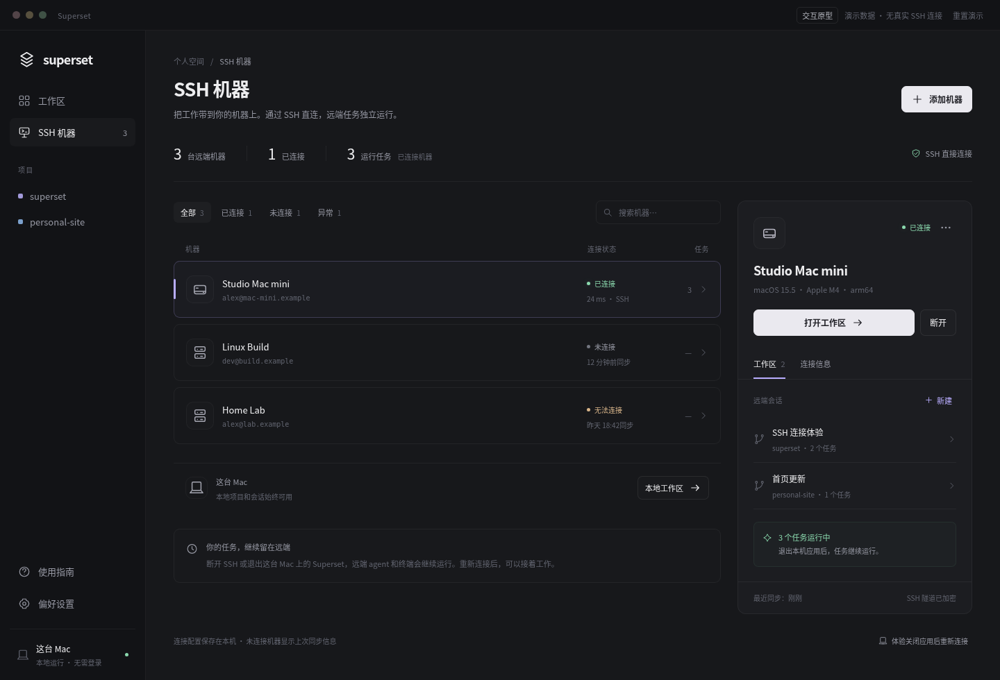
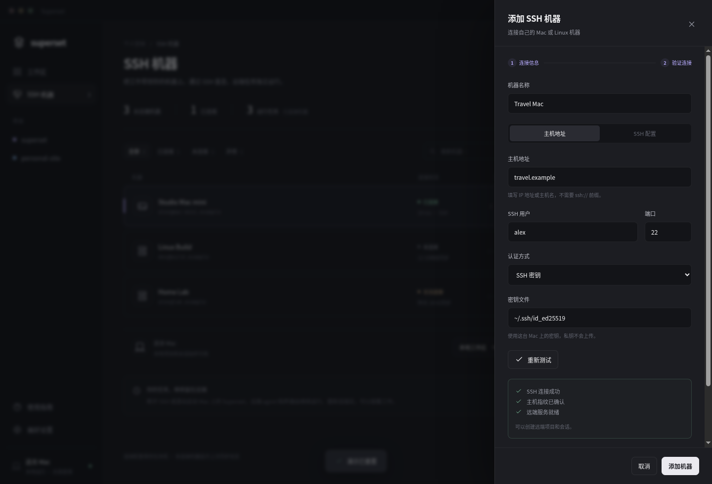
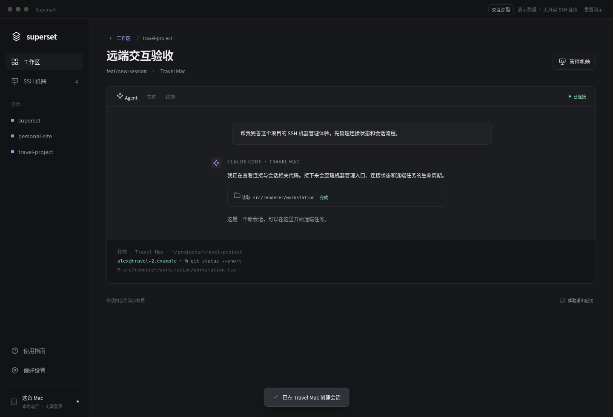

# SSH 机器管理交互原型

[ssh-machines.html](./ssh-machines.html) 是一个独立 HTML 文件，下载后用浏览器打开即可使用。CSS、JavaScript 和图标均内嵌，不需要安装依赖或连接服务。所有地址、指纹、项目和会话都是演示数据；刷新页面或点击「重置演示」恢复初始状态。

机器管理在侧栏有独立入口，使用机器列表与详情面板；连接表单放在添加/编辑抽屉里。工作区页面负责添加项目和新建会话，通过「运行位置」选择本机或已连接的 SSH 机器。

可以按下面的顺序试用：

1. 选择 Studio Mac mini，查看工作区与连接信息；点击「断开」再连接，观察任务数与同步状态。
2. 添加机器，填写名称、演示主机地址和用户名；测试连接，确认演示指纹，再保存。也可以切换到「SSH 配置」使用演示别名。
3. 打开新机器的工作区，添加该机器上的项目，再创建会话。新建会话只列出所选机器上的项目。
4. 点击「体验关闭应用后重新连接」，重新打开后恢复连接配置，连接原机器继续原来的会话。
5. 在机器的「连接信息」中选择「停止远端服务」，确认终止任务。之后重新连接需明确启动服务，已停止的任务不会恢复运行。
6. 选择 Home Lab 模拟连接失败；添加机器时使用含 `offline` 或 `fail` 的主机名，也会进入失败状态。

未连接时任务数和工作区标为上次同步信息。移除操作只移除本机连接配置；停止服务是单独的确认流程。

本次只添加设计原型，没有接入 Electron、SSH、文件系统或真实 agent，也没有修改已发布 DMG。项目目录与工作区内容用于展示交互关系。

2026-10-12 验证：在 Chromium 中用 CDP 鼠标与键盘输入完成 25 项检查，覆盖筛选、主机与别名添加、指纹确认、修改配置后重新验证、断开与重连、退出后恢复、项目与会话创建、停止与重新启动、失败与移除流程。1440、1024、768、390 px 窗口下检查布局，未发现横向溢出；控制台无 JavaScript 错误。抽屉的标题与底部操作保持可见，Escape 关闭后焦点返回添加按钮。这些结果只验证此 HTML 原型。

