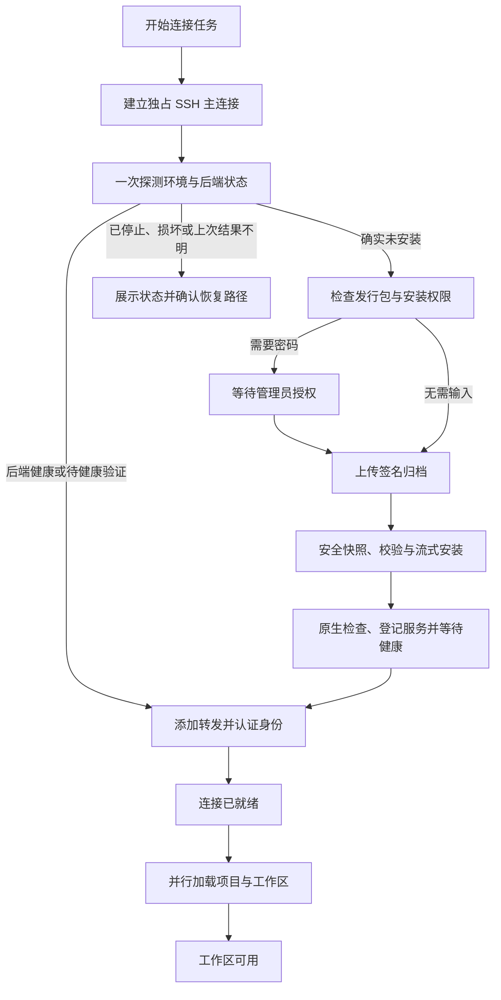

# SSH 机器连接与自动安装：性能和进度展示设计

日期：2026-10-13。状态：核心性能方案与阶段反馈已实施，原生 Mac 对比验收进行中；完整授权任务、协作取消、缓存和续传仍为后续设计。

研究基线：当前工作树，HEAD 为 `faeca5c1d082e0680dc99d94abd390064dbc528a`。工作树包含其他进行中的修改，因此 HEAD 不代表调查文件的完整快照。本次只新增设计文档。

## 1. 目标与主要决定

让添加 SSH 机器、首次安装后端和日常重连都更快；等待时明确显示正在执行的步骤、已有进展，以及需要用户处理的事项。

建议保留系统 OpenSSH 和现有签名信任体系，按以下顺序实施：

1. 建立主进程持有的连接任务，贯通真实阶段事件、计时、管理员授权和取消。先让当前流程可观测。
2. 将一条应用独占的 SSH 主连接用于探测、上传、安装和转发，合并重复探测，复用已认证的健康响应。
3. 在构建时生成签名清单覆盖的压缩归档，一次上传；安装器从不可变归档快照流式写入同卷暂存目录，消除按文件启动读取进程及整套二次复制。
4. 日常重连走独立短路径；完整安装包复用、分段续传和发行包裁剪根据实测继续推进。

验收同时看首次安装耗时、重连耗时和用户可见反馈，不能用进度动画代替性能改善。签名、文件摘要、远端身份、权限隔离和已有任务的持续运行仍是约束。

## 2. 研究范围与证据边界

已阅读桌面主进程、preload/IPC、机器管理界面、连接状态机、OpenSSH 运行时、安装与特权读取、发行清单、构建器、服务控制，以及真实 SSH 安装验收脚本；另查阅 OpenSSH 的复用、SFTP 续传和协议扩展文档。

初稿调查时，工作区没有后端发行清单或分阶段性能记录。以下为当时的证据边界；本次实施与实测以第20节及实现记录为准：

- 下文关于重复调用、进程数量阶数、同步校验和界面状态的结论来自源码。
- 数千文件场景是需要覆盖的基准规模，实际发行包文件数、大小和压缩率须从新基线记录取得。
- 性能目标、示例大小与估算均是设计值，不是已测结果。
- 现有 Mac 验收脚本的通过条件证明流程正确性，不等于广域网性能已验证；本次没有重跑该脚本或连接用户机器。

本设计补充[现有 SSH 后端设计](ssh-direct-backend.md)，沿用其进程所有权、系统服务和升级维护边界。

## 3. 优化前流程与耗时来源（调查基线）

### 3.1 首次连接调用链

```text
界面 connect
  → 断开当前连接、清空页面数据
  → 主进程再次 disconnect(id)
  → manager.testProfile：环境探测 + 读取 endpoint
  → resolveBackend：再次读取 endpoint
  → 桌面 install 回调：探测完整安装环境
  → installRemoteBackend：同步校验本地全部文件 + 再探测安装环境
  → 磁盘检查、incoming 配额检查、分批 mkdir
  → 一个 SFTP 批次，逐文件 put
  → sudo：为各文件启动独立读取进程
  → 校验 payload、复制到系统暂存目录、再次校验、发布
  → 原生模块检查、launchd 登记、远端认证健康检查
  → 删除 incoming、再次读取 endpoint
  → 新建 SSH master、添加转发、认证 describe
  → controller.features：再请求一次 describe
  → 并行读取项目和工作区列表
```

当前已经使用一次 SFTP 批量上传，不能再把性能问题归结为“每个文件重新建立 SFTP 连接”。批次内仍逐文件执行 `put`，而安装端仍按文件启动读取进程。[E01] [E02] [E03]

### 3.2 已确认的问题

| 问题 | 源码依据 | 对等待时间或体验的影响 |
| --- | --- | --- |
| 大多数控制命令独立 SSH 握手 | `sshArguments` 固定 `ControlMaster=no`、`ControlPath=none`；只有 `forward` 后期创建 master。[E01] | 探测、mkdir、授权、清理均增加网络和认证开销；高延迟网络更明显。 |
| 重复探测与 endpoint 读取 | manager 先探测并读 endpoint，resolve 再读；桌面 install 回调与安装函数各探测一次。[E02] [E03] [E04] | 重连也要重复走三次远端命令；首次安装重复取得相同用户和架构数据。 |
| 批次内逐文件传输 | `sftpUploadBatch` 为每个文件生成 `@put`；目录每 50 个执行一次 mkdir。[E01] [E03] | 小文件的 OPEN/WRITE/CLOSE 和目录元数据操作占用时间；只有大文件内部能充分利用传输流水线。 |
| 逐文件启动特权读取子进程 | `installAsRoot` 遍历文件；`readIncomingPayload` 每次 `execFileSync('/usr/bin/head', …, {uid,gid})`。[E05] [E06] | 文件越多，进程启动次数越多；上传结束后仍可能长时间等待。当前做法承担了隔离可变用户路径读取的职责。 |
| 额外复制和多次读取整包 | payload 校验后 `cpSync` 到 staged，再做完整校验；本地 `verifyReleaseBundle` 同步读取和计算所有摘要。[E03] [E05] [E07] | 首次安装重复磁盘 I/O；本地校验占用 Electron 主线程，影响 IPC 和进度反馈。 |
| 健康响应未复用 | manager 已取得 `/direct/describe`，主进程再调用 `features` 请求相同接口。[E02] [E04] [E08] | 增加一次串行请求与后端能力检查。 |
| 进度没有抵达界面 | manager 只有状态 Map；已有连接事件用于自动重连，初次安装没有阶段事件。[E02] [E09] | 用户只能看到按钮不可用和最终结果，不知道在上传、安装还是等待服务。 |
| 全局 busy 与授权位置不合适 | hook 使用全局 `operationBusy`；密码藏在连接详情的高级设置中，缺少密码直到上传后才失败。[E03] [E10] [E11] | 等待期间其他操作受限；授权失败可能使用户重做耗时上传。 |
| 重复点击会重建已有连接 | manager 有 pending/lease 去重，但 IPC connect 入口先无条件 disconnect。[E02] [E04] | 入口绕过 manager 的复用意图，也增加重复连接的竞态。 |
| endpoint 存在被当作已安装 | `installed` 仅表示 endpoint 和 secret 能读到。[E02] | 无法区别正在启动、崩溃、显式停止、文件损坏与真正缺少安装，恢复路径不清楚。 |

### 3.3 用于定位的成本模型

令 `F` 为后端文件数、`D` 为要创建的目录数、`U` 为展开后的大小、`C` 为归档大小、`B` 为有效上传吞吐率、`H` 为一次独立 SSH 连接的平均成本。

当前默认首次安装路径，静态调用数约为 `12 + ceil(D / 50)` 次独立 SSH/SFTP 网络认证连接：10 次 SSH 控制命令、目录创建命令、1 次 SFTP 和1 次转发 master。不包含此前单独点击“测试连接”、跳板机的额外握手或失败重试。日常重新连接至少包含 3 次独立 SSH 命令和1 次 master 建立。

```text
当前首次安装 ≈ 多次握手 + U/B + 小文件协议开销
              + (F−2)×读取进程成本 + 多遍校验/复制 + 启动/认证

目标首次安装 ≈ 一次握手 + C/B + 常数个读取/解压进程
              + 归档校验 + 流式逐条目校验/写入 + 启动/认证
```

例如，若有 6,000 个文件，单次进程开销假设为 5 ms，仅逐文件启动就约为 30 秒。这只是敏感性分析，不是 macOS 实测。不能据此承诺整体提升倍数；须测量网络传输、进程开销和磁盘阶段各占多少。

## 4. 用户体验设计

### 4.1 添加机器与首次连接

新增机器抽屉保留“仅保存”，主操作改为“保存并连接”。“测试 SSH”是可选只读操作，无需先测试才能连接，也不会安装后端。

保存并连接后，机器详情自动展开进度卡。它位于主内容中，不藏在高级设置；列表行同时显示“正在连接”“正在上传”或“需要授权”。进度卡只属于目标机器，切换查看另一台机器不会取消当前任务。

```text
Mac mini                         正在上传后端

✓ SSH 连接已建立
✓ 已检查远端环境
✓ 安装权限已确认
● 正在上传后端   42 MiB / 120 MiB · 6.8 MiB/s
○ 正在校验并安装
○ 正在启动服务
○ 正在验证连接

已用时 12 秒                     [取消] [查看详情]
```

以上数字是交互示例。实际显示来自任务事件；上传占比只描述上传阶段。上传到 100% 后切换“传输收尾”或“校验安装包”，不表示整个连接已完成。

### 4.2 默认显示与详细信息

| 阶段 | 默认显示 | 有实际计数时的补充 |
| --- | --- | --- |
| 建立 SSH | 正在连接机器 | 已用时、重试次数；错误时显示可执行的处理建议。 |
| 探测 | 正在检查远端环境 | 检查完成后显示 macOS、架构、已有后端状态。 |
| 本地校验 | 正在检查安装包 | 已校验字节或文件数量；不显示文件路径。 |
| 等待授权 | 需要目标 Mac 的管理员授权 | 内嵌密码输入；等待不计入主动执行耗时。 |
| 上传 | 正在上传后端 | 暂存大小、总大小、采样速率；可用时显示上传阶段剩余时间。 |
| 特权准备 | 正在准备安全安装 | 不可变归档快照、归档摘要检查，使用不定进度。 |
| 解包与安装 | 正在校验并安装后端 | 已验证字节、条目数；只有落盘并验证后才增加计数。 |
| 原生检查 | 正在检查运行环境 | 对原生模块/PTY 的检查结果。 |
| 启动 | 正在启动后台服务 | 子状态为已登记、等待 endpoint、等待认证响应。 |
| 转发与认证 | 正在验证连接 | 失败时区别网络、认证、身份与协议不兼容。 |
| 数据加载 | 已连接，正在加载项目和会话 | 项目、工作区独立加载状态。 |
| 完成 | 已连接 | 显示本次总耗时；首次安装提示以后连接会复用后端。 |

“查看详情”展示结构化步骤、每步耗时、是否复用、已脱敏错误和诊断编号。默认界面不展示 `launchctl`、目录路径、原始 SSH 命令和数千个文件名。

未知阶段使用不定进度，不按固定时间递增百分比；不提供没有依据的整体 ETA。上传有足够稳定样本后才能提供上传 ETA，阶段切换后清除。

### 4.3 授权流程

首次安装发现缺少后端后，先检查与真实安装相同的 sudo 命令授权范围。不能用 `sudo -v` 或能执行 `sudo true` 推断安装脚本也被允许。

- 可免密执行时直接继续。
- 需要密码时在进度卡内说明“用于在目标 Mac 安装后台服务”，请求目标账户密码。
- 通过现有标准输入密码封装执行一个固定的无副作用授权检查，再上传大型包。最终安装重新取得授权；sudo 缓存可能过期，预检不代表最终授权永远有效。
- 密码只关联本次 job/连接世代，存在主进程短期内存中，授权失效、取消或任务结束时清除引用；不存入 SQLite、localStorage、诊断或进度事件。不要宣称 JavaScript 字符串能够可靠清零。
- 若最终授权失效，重新请求授权并复用已完整上传、核对过的归档，不重新上传。
- 普通重连不请求管理员密码。自动重连不会新增安装、启动显式停止的服务或打开密码窗口。

### 4.4 可交互范围与取消

页面滚动、查看其他机器、展开详情、输入授权信息和取消仍可使用。任务期间只禁止同一机器的编辑、删除和冲突的安装/维护操作；单个活跃工作区的切换仍遵守现有所有权规则。

- 探测、校验、授权等待和上传可以立即请求取消；取消的是连接任务和客户端资源。
- 特权安装开始后使用协作取消。到发布/服务登记的短临界段，按钮显示“取消请求已收到，正在完成安全步骤”，避免在目录重命名、配置或 journal 更新中途硬杀进程。
- 取消不会停止已经运行的远端 agent 或后端。已发布的发行目录可以保留，按现有保留策略回收。
- 客户端异常退出或 SSH 中断不能等同于远端安装已撤销。再次连接先查 journal 和健康状态，显示“正在确认上次安装结果”；结果未确认前不盲目重做特权修改。

无障碍：步骤使用 `aria-live="polite"`，只播报阶段变化和重要错误；字节采样不逐帧播报。已完成、进行中、等待输入、失败均同时使用文字和图标，支持键盘聚焦授权和取消；新增文案按仓库 Lingui 规范翻译。

## 5. 连接任务与状态契约

### 5.1 将连接过程从单个长 Promise 提升为任务

主进程拥有 `SetupJob`；连接管理器、安装器和运行时报告事件，renderer 显示快照并提交授权/取消。主进程任务以认证连接就绪为终点，不依赖某个组件仍然挂载。renderer 随后的项目/工作区加载是独立子状态，复用同一进度卡。

建议在已有 API 旁新增：

```ts
beginConnect(connectionId): Promise<SetupSnapshot>
getSetupSnapshot(connectionId): Promise<SetupSnapshot | null>
onSetup(listener): () => void
provideSetupAuthorization(jobId, generation, challengeId, password): Promise<void>
cancelSetup(jobId, generation): Promise<{ requested: boolean }>
```

`beginConnect` 先创建 job 并立即返回，之后任务在主进程运行；重复调用返回同一任务。认证成功的终态快照携带无秘密的 `DirectDescriptor`，renderer 据此绑定连接并发起列表加载。保持现有 `connect(id, password)` 兼容入口，内部加入同一任务并等待认证结果，逐步迁移界面和验收脚本。

不要将首次安装事件直接塞入当前按 `previousGeneration` 过滤的自动重连监听器：首次连接还没有 active descriptor，会被过滤。[E09] [E10] 新增独立 setup channel；自动重连的阶段反馈也采用同一数据模型，现有重连通知继续提供 descriptor 替换语义。

### 5.2 快照结构

```ts
type SetupPhase =
  | "connecting" | "probing" | "checking-release"
  | "awaiting-authorization" | "preparing-upload" | "uploading"
  | "preparing-install" | "installing" | "checking-runtime"
  | "starting" | "forwarding" | "verifying";

interface SetupSnapshot {
  connectionId: string;
  jobId: string;
  generation: number;
  sequence: number;
  status: "running" | "waiting-input" | "cancel-requested"
        | "completed" | "failed" | "cancelled" | "reconciling";
  phase: SetupPhase;
  stepCode?: string;
  startedAt: number;
  elapsedMs: number;
  phaseElapsedMs: number;
  lastActivityAt: number;
  progress?: {
    unit: "bytes" | "files";
    completed: number;
    total: number;
    basis: "verified" | "remote-file-size";
  };
  cancelMode: "immediate" | "cooperative";
  descriptor?: DirectDescriptor;
  authorizationChallenge?: { id: string; expiresAt: number };
  error?: { code: string; retryable: boolean; diagnosticId: string };
}
```

这是新增契约草案，不是现有类型。用户文案由 `phase/stepCode/error.code` 在界面翻译；不让原始 stderr 充当协议或错误分类。

约束：

- `jobId` 区分两次用户尝试；`generation` 沿用连接租约隔离；每个 job 的 `sequence` 单调增加。
- 事件在主进程经过 schema 校验、世代检查和脱敏，之后才发给 renderer。
- 同一步的计数单调且不超过 total；新任务或新阶段可以重置，不人为维持跨阶段总百分比。
- renderer 先订阅再读取快照，以 sequence 合并两者；切页或重载后继续显示当前任务。
- 时间跨度使用主进程单调时钟计算，墙上时间只用于显示和诊断；避免系统时钟调整造成负耗时。
- 计数事件合并到每秒最多 5 次，阶段/授权/终态即时发送。主进程保留每个连接最新快照及有限步骤记录，不存每次字节采样。
- 主进程任务历史默认上限 50 次或 7 天；诊断只存有界本地文件/SQLite，随连接删除或 TTL 回收。renderer localStorage 不增加按机器累积的日志集合。
- 初始传输认证完成与列表加载完成分别记录 `transportReadyMs` 和 `workspaceReadyMs`。前者由主进程记录；后者由 renderer 以自身点击时刻和单调时钟计算，不能相减两个进程的时钟。两项以 jobId 关联。
- renderer 的 `loading-workspaces` 子状态按 generation 绑定，用独立查询/`Promise.allSettled` 更新项目和工作区。加载失败不把已认证连接重新标记为安装失败；某个列表成功后可以先展示，另一个提供重试。

取消分两层实现：普通阶段的 AbortSignal 终止本job的channel；特权阶段通过与installId绑定的有界取消标记请求停止。标记由目标UID写入已授权的固定私有路径，安装器在安全阶段边界经隔离读取器核对owner、类型、大小与installId后处理，不能让它指定任意删除路径。临界段内延后响应；取消时不能先调用当前 `manager.disconnect` 将master及所有channel硬杀，再期待特权安装协作完成。应用异常退出仍以journal对账为准。

### 5.3 状态流



“待健康验证”指有合法 endpoint，仍须通过 SSH 转发认证；不因 endpoint 文件存在就报告健康。

## 6. SSH 复用与重连短路径

### 6.1 将 master 的创建提前

由运行时管理 `OwnedSshSession(connectionId, generation, profileFingerprint)`：

1. 在权限为 0700、路径足够短的应用私有临时目录创建控制 socket。
2. 以前台 `ControlMaster=yes`、`ControlPersist=no` 建立 master；沿用主机密钥校验、BatchMode、禁止 agent/X11 转发等现有配置。
3. 远端 exec、SFTP 和 forward 都显式使用这一个 socket；继续支持用户 SSH alias、端口、密钥和 ProxyJump。
4. 用受控 `ssh -O check` 检查 master 就绪，不能只凭 socket 路径存在。
5. 主进程/watchdog 持有生命周期，断开、配置变化、取消和应用退出只关闭自己创建的进程与 socket；不操作用户已有 ControlMaster。

OpenSSH 的复用客户端在 socket 不可用时可能回退到新连接。[R01] 因而应在加入 channel 前检查 session 世代和 master 状态，记录实际连接次数；丢失 master 时终止当前世代并重新建立、探测和验证。不能仅依靠 `ControlMaster=no` 保证绝不回退，也不能沿用旧世代的 endpoint/身份假设。

选项生成拆分为 master、command、subsystem 和 control 操作四种类型。SFTP 仍不能携带冲突的 `SessionType=default`；不要依靠删除数组中某个字符串推导所有参数。

上传初始只使用一个 SFTP channel，进度采样最多占用一个短命令 channel，避免超过 sshd 的 MaxSessions。后续多路并发由测量决定，不以大量并行 SSH 连接作为默认方案。

### 6.2 一次探测，按结果分支

在一次有版本的、大小受限的远端响应中返回用户 UID/用户名/组/home、macOS/架构、endpoint 状态、已安装服务配置及停止/安装 journal 状态。远端 secret 单独属于主进程内部数据，绝不进入事件和诊断。

将探测结果带入安装回调选择目标发行包，避免 desktop 与 installer 再次重复探测。特权执行时仍核对 OS 账户、目录和发行包；跨越权限边界的复核具有不同用途，不能作为“重复探测”删除。

只读测试与连接共用探测实现。测试结果不充当长期身份凭证；若测试后短时间保留 master 以供连接，须有明确的短 TTL 和 profile/config 失效规则，并重新检查 endpoint。此复用是后续可选优化，不是第一阶段依赖。

### 6.3 日常连接路径

```text
新客户端：一次 master 建立 → 一次探测 → 添加转发 → 一次认证 describe
已有健康租约：直接返回租约/描述，后台刷新数据
自动重连：按已有退避策略重建 session → 探测 → 转发 → 认证 → 恢复订阅
```

manager 的首个认证 describe 同时取得身份与能力。校验身份后，缓存该响应的能力字段，按 generation/instanceId 绑定；主进程不立即再请求相同接口。显式“刷新运行环境”仍可重新检查。

有兼容后端时不校验本地整包、不上传、不安装、不检查管理员权限；本地客户端携带更新包不意味着每次连接都升级远端。已有协议不兼容时解释升级要求，仍遵守既有 drain/激活流程。

对不同情况分别处理：

| 远端状态 | 连接行为 |
| --- | --- |
| 服务可认证 | 走短路径。 |
| 已登记且正在启动 | 有限等待健康，显示启动阶段。 |
| 用户显式停止 | 提供“启动并连接”，不自动覆盖停止意图。 |
| 有配置但无健康服务 | 查询受限诊断，提示恢复/启动；不把它当全新机器重新上传。 |
| endpoint/身份损坏或改变 | 阻止绑定旧缓存，要求核实目标；不自动修复身份。 |
| 确实未安装 | 仅显式连接进入自动安装。 |
| 上次安装状态不明 | 先对账 journal、发行目录和服务健康，再决定恢复。 |

### 6.4 方案取舍

| 选项 | 取舍 |
| --- | --- |
| 多个并行SFTP逐文件上传 | 可改善部分延迟，但仍有O(F)传输元数据及安装读取进程，也增加channel与失败恢复复杂度；不作为主方案。 |
| rsync | 可提供差量传输，但引入两端可用性、版本及协议兼容条件；先解决首装的单归档与进程开销，再用实测判断是否需要差量。 |
| tar直接经SSH stdin传输 | 数据路径简单，但本地stdin写入量不能代表远端收到；本轮复用已验证的SFTP，避免同时新增上传与进度协议。 |
| 替换为完整SSH库 | 会扩大alias、ProxyJump、ssh-agent与主机密钥行为的兼容范围；系统OpenSSH已经满足连接需求，不为性能问题重建认证栈。 |
| 远端下载Node/依赖或运行包管理器 | 首装依赖外网、镜像和依赖解析；携带完整且预先构建的签名包更便于预测和验收。 |
| 单归档＋独占master＋流式受控安装 | 同时减少握手、小文件协议和子进程开销，并保留现有连接、信任和原生发行体系；采用此方案。 |

## 7. V2 单归档发行格式

### 7.1 构建时生成，连接时直接发送

每个目标架构提供三个文件：

```text
direct-backend/darwin-arm64/
  release-manifest.json
  release-signature.json
  backend.tar.gz
```

x64 使用对应目标目录。桌面端携带两种架构资源，但只上传目标机器需要的一套。

归档只包含现有 manifest.files 中的发行文件，含隐藏文件、运行时、原生模块和迁移；不包含 manifest/signature 自身。这样先生成归档，再把归档摘要加入清单并签名，不产生“归档摘要包含自己的清单”的循环。

新增 V2 清单，保留现有业务/ABI 字段和逐文件摘要：

```ts
interface ReleaseManifestV2 {
  formatVersion: 2;
  // version、target、protocolVersion、schemaVersion、Node ABI 等沿用 V1
  files: ReleaseFile[];
  archive: {
    path: "backend.tar.gz";
    compression: "gzip";
    size: number;
    sha256: string;
    unpackedBytes: number;
    entryCount: number;
  };
}
```

签名覆盖 archive 与 files 的全部字段；`unpackedBytes`、`entryCount` 必须与文件清单一致。压缩大小遵守当前 incoming 单槽 2 GiB 上限，展开大小/条目数继续受限；不因压缩包很小而允许无限解压。

使用可复现归档：稳定排序、固定时间戳和 owner/group、明确模式、禁止符号链接与特殊文件，关闭额外 macOS 元数据。签名/codesign 完成后再归档。CI 比较 gzip 压缩级别 1 和6 的大小与解压成本后固定配置；客户端不临时压缩。

构建器应直接产出 V2 资源，不同时在最终 DMG 重复携带完整展开目录和归档。CI 验证需要的展开目录是构建暂存物；本地内置后端继续使用现有桌面运行资源。

### 7.2 兼容与降级

- 新客户端支持 V1 展开目录和 V2 归档；手动选择的旧发行目录仍走 V1 安装路径。
- V2 自带 V2 bootstrap/安装器，能用于全新机器，不依赖远端先安装新软件。
- 发行格式版本与后端业务协议版本分开；V2 不必改变现有 direct RPC 协议。
- V2 签名、归档或条目校验失败时直接报告损坏，不能自动转到跳过校验的路径。
- 旧客户端不理解 V2，因此不能将 V2 元数据覆盖进它正在使用的发行目录；新发行物使用新的不可变 releaseId。

## 8. 传输优化与上传进度

主方案保留现有 OpenSSH SFTP CLI，一批上传 manifest、signature 和归档，传输操作从与 F 成正比下降为常数；目录创建也降为一次。已压缩归档不再开启 SSH 传输压缩。

首版上传进度采用通过同一 master 进行的受控远端采样：

- 最多每秒一次，读取本次 UUID.partial 中归档的文件类型、owner 和逻辑大小；一次最多一个采样请求，不堆积。
- 固定脚本/结构化返回，只接受本次预先生成的路径；大小必须在 `[0, signedArchiveSize]` 内。
- 计数的语义是“远端暂存文件逻辑大小”，标记 `basis=remote-file-size`，不是 SFTP WRITE ACK、完整字节验证或磁盘持久化证明。流水线乱序写入可能使逻辑大小提前增长。
- 上传阶段可显示这个近似占比；达到预期大小后显示“传输收尾”，直到 SFTP 成功关闭且最终大小检查通过，才能进入安装。最终可信结果来自归档摘要校验。
- 速率/ETA 标注为估算，以多次大小增量的平滑窗口计算。采样失败或停滞时隐藏速率/ETA，不将其冒充上传失败，也不因 UI 计数静止而立即重传。
- 分阶段计时比较开启/关闭采样的开销；目标附加开销小于 3%。若达不到，降低采样频率，保留阶段和 elapsed 显示。

选择该方案是为了复用已经验收的传输实现，避免为显示进度同时替换 SSH/SFTP 协议栈。不要解析 CLI 终端进度条、伪造时间百分比或把写入本地 ssh stdin 的字节称为远端已接收。

若后续产品需要精确 WRITE ACK 计数，单独评估成熟的 SFTP 流解析库接到系统 `ssh -s sftp` 的 stdin/stdout，保留系统 SSH 配置能力。支持 INIT/OPEN/WRITE/STATUS/CLOSE、包长限制与有界请求窗口；遵守 `limits@openssh.com`，ACK 也不等于 fsync。[R03] 它是可替换进度后端，不是本轮性能优化的先决条件。

## 9. 安装端优化与信任边界

### 9.1 常数个读取进程替代按文件读取

现有逐文件降 UID 的读取不能直接改为 root 对 incoming 执行 `tar -xf`：incoming 属于 SSH 用户且可变，里面可能被替换为链接或特殊文件。[E05] [E06]

V2 流程如下：

1. 客户端在后台工作线程验证清单签名、目标架构及归档摘要，构造经过验证的 bootstrap 参数；继续通过标准输入发送大请求。
2. 特权 bootstrap 创建 root 私有工作目录，用一个指定 UID/GID、环境受限的 reader 读取上传归档，最多接受 `C+1` 字节。采用流式背压、有限超时；禁止 `execFileSync` 把整个归档装入内存。
3. 把读取结果保存为 root 私有不可变快照，检查精确大小及预期 SHA256。摘要不匹配即结束；从此不再读取用户可变 incoming。
4. 使用系统 tar 仅将快照中的 `lib/node` 和 `lib/direct-installer.js` 输出到 bootstrap 固定文件。输出大小受清单上限限制，检查这两个文件各自的 SHA256、设定执行权限后才运行 Node。这个引导归档摘要来自客户端已验证的签名清单，与现有 bootstrap 接受客户端已验证 Node/installer 摘要的信任起点一致。
5. 新 Node 安装器重新验证清单签名、archive 字段和账户身份，之后才创建运行时条目。归档解码使用经审核的流式库，拒绝路径越界、重复名称、链接、特殊文件及未列出的条目；不运行 root 的通用整包 `tar -xf`。
6. 流式写入每个文件并计算摘要；大小或摘要不符立即废弃候选。逐条目操作在同一安装进程中完成，不再按文件 spawn reader。

步骤4须在两种原生 Mac 上验证系统 tar 对所选受限归档格式的行为。归档采用普通文件和受限路径编码；如支持 PAX 长路径，先规范化最终路径，只接受所需字段并限定长度。bootstrap 重复匹配条目会导致大小/摘要失败；完整解包器仍显式拒绝重复。

### 9.2 一次写入最终暂存位置

系统布局建议：

```text
/Library/Application Support/SupersetDirect/
  .staging/<installId>/           root:711，仅允许遍历
    private/                     root:700
      archive.snapshot           root:600
      bootstrap/                 root:700，已校验的临时 Node/installer
    payload/                     候选运行时文件树
  runtime/<releaseId>/           发布后的不可变运行时
```

候选 payload 与最终 runtime 位于同一文件系统，校验、权限设置和目标 UID 的原生 smoke 通过后原子 rename 发布；不再从 `/private/tmp` 的完整 payload `cpSync` 到 staged。

`.staging` 祖先与 installId 目录只允许遍历、不允许其他用户列目录或写入；`private` 仍禁止目标 UID 访问。payload 的目录/文件在 smoke 前设为最终可读、只读运行权限，使普通服务用户能够实际加载候选。不能把整个候选放在不可遍历的700祖先内，再声称已以目标 UID 通过 smoke。

校验可以合并遍历，不能合并信任边界：保留归档快照摘要、逐条目大小/摘要、最终条目集合/权限检查和目标用户原生 smoke。发布前仍扫描一次元数据；若受控写入与不可变 snapshot 已足以保证内容，避免无用途的第二遍全文重哈希。已存在的 releaseRoot 不因名称相同就被信任，继续完整验证后才能复用。

校验及 chmod 的时间也记录下来；文件多时仍有 O(F) 本地文件系统开销，单归档不会把它降到 O(1)。优化的是握手、传输元数据、子进程启动和多余整包读写。

### 9.3 锁、容量与服务发布

- 账户上传缓存准入锁、系统发行安装锁、用户 namespace 锁沿用固定顺序；不得移除多用户共享系统目录的锁。
- 快照/解包阶段可在 installId 私有目录准备，最终发布和服务变更仍在系统锁内；缩短持锁范围须独立验证并发安装，不直接把所有锁都推迟。
- HOME 盘预算为压缩 incoming `C` 加元数据；系统盘预算包括 snapshot `C`、候选 `U`、现有保留版本和 reserve。分别查两处所在卷；同卷时合并峰值 `2C+U+reserve`，不能把展开后大小忽略。沿用现有容量上限并根据新布局重算。
- 运行时目录由 root 持有且可被服务 UID 遍历；运行文件只读，可执行位按已验证清单设置。私有身份、凭据和 journal 仍保持 0600/0700。
- 新安装先原生检查再登记/健康验证；已运行的后端无需因候选发布而重启。候选升级继续分离 stage 与 activate，尊重活跃任务和显式停止状态。
- 发布、用户配置、launchd 登记和 committed journal 增加可恢复的阶段记录；若发现已发布但未提交的候选，先对账，不能重复创建新 identity 或覆盖正在使用的配置。

## 10. 安装进度如何跨 SSH 抵达界面

运行时 exec 增加有界、即时的数据回调与 AbortSignal，保留现有收集 stdout/stderr 并返回结果的兼容接口。归档仍由SFTP传输；root侧snapshot reader使用独立二进制流，不进入当前 4 MiB 命令输出缓冲。

安装器输出明确的逐行事件，例如：

```text
SUPERSET_DIRECT_EVENT={"v":1,"installId":"…","seq":12,"phase":"installing","verifiedFiles":380,"totalFiles":6000}
SUPERSET_DIRECT_INSTALL={"identity":{…},"releaseId":"…","status":"installed"}
```

保留已有最终结果 marker；事件不是 committed 结果的替代。[E03]

- 只接受完整的一行，处理 UTF-8 和分块边界；单行进度事件最多 16 KiB，整体收集继续有上限。
- 事件只含白名单字段、计数和 code。主进程检查 installId、序号、状态转换及清单边界，不能让远端任意文案、文件名或控制字符进入主界面。
- 普通 stdout/stderr 为脱敏诊断；shell 登录噪声和无法识别的行不当作进度。与输出溢出/协议错误分别处理。
- helper 子进程事件须在父安装器实时转发，不能继续让 `execFileSync` 缓存全部内容直到退出。以 spawn/流式处理替换相关等待，限制并发。
- 校验/解包报告实际完成字节与条目；等待锁、原生检查和健康检查报告明确阶段。心跳只表示处理进程仍活着，不增加进度，不刷新“实际进展”时间。
- 命令退出码为0但没有合法 committed marker 仍是结果未确认；必须查询 journal，不能显示已安装。

## 11. 超时、停滞与重试

当前 `ConnectTimeout=10` 只覆盖 SSH 建立，不给上传和远端命令完整的应用层时限；健康循环也受每次请求超时影响，不能把“30×100 ms”理解为三秒整体超时。[E01] [E02]

统一用每阶段 deadline、总执行预算与可取消的请求，区分主动耗时和等待输入。初始参数需要基线验证：

| 阶段 | 建议初值 | 触发后的行为 |
| --- | --- | --- |
| master 建立 | 10 s | 归类网络/认证失败；有限重试只用于暂态网络问题。 |
| 探测/短控制命令 | 10 s | 终止本次命令，展示所在阶段；不自动安装。 |
| 等待管理员输入 | 5 min 挑战有效期 | 清除授权引用并安全暂停/取消，用户可重新开始授权。 |
| 上传 | 60 s 没有可观测传输进展时检查疑似停滞；默认总上限 30 min | 先核对 transport 和暂存状态；UI采样失败或逻辑大小静止本身不触发终止。显示诊断/取消；整体deadline到期才结束无法确认的传输。 |
| 快照/解包/校验 | 大小相关预算，初始上限 10 min | 对账 journal，废弃未发布候选；不影响已有服务。 |
| 服务启动与认证 | 共用 60 s 整体 deadline | 请求受限服务日志/状态，显示启动或认证的具体失败。 |

每5秒更新 elapsed；超过相应阶段基线 P95 或连续15秒没有实际进展时显示“此步骤耗时较长”与当前步骤。只收到心跳显示“仍在处理，暂无新进度”；不要假称断线，也不要永久旋转而没有时间信息。

重试原则：

- 身份、签名、密码错误、磁盘不足和显式停止不自动重试。
- 网络错误使用已有有界退避；重试开始新 generation，旧事件不得覆盖新任务。
- 特权结果不明先查询，不盲目重放安装。已完整上传的归档可以在同一任务恢复授权后复用，但依然重新验证实际内容。
- 自动重连保持已有“不自动安装”边界；显示第几次尝试以及下一次等待时间。

## 12. 缓存与续传分阶段处理

### 12.1 首版：复用已完整上传的归档

当前安装函数无论成功失败都在 finally 删除 incoming。[E03] 改为按结果清理：成功后删除；错误需要重新授权或结果待确认时，保留归档及 installId 以便同一次任务继续。校验失败和用户明确取消的未提交传输可删除。

保留仍受现有4槽、每槽2 GiB限制，并增加 lease、明确过期时间（初值24小时）和总配额；仅清理已证明废弃的槽。活跃传输/安装不因 TTL 被删除，不仅凭 PID 存在推断归属。缓存命中依赖目标身份、UID、target、releaseId、归档 digest 和精确大小，不能只看文件名。

跨客户端/重启的复用若没有可靠 journal/lease，只做状态对账后全量重传。UI 不提前承诺“可随时续传”。

### 12.2 后续：经验证的分段续传

OpenSSH `reput` 假设本地和远端已有前缀一致；仅凭远端文件长度不能证明此前内容正确。[R02]

若实测慢网中断损耗明显，再增加构建时生成并签名覆盖的块索引，例如8 MiB一块。新会话核对缓存身份并验证已完成块，记录连续有效前缀；缺失/错误块重传，最终仍验证完整归档摘要。块索引属于签名发行元数据，并受条目/大小上限限制。

该阶段与首版单归档/进度改造分开交付，避免为了续传首先引入复杂的新协议。

## 13. 发行包体积的后续优化

构建器当前递归复制运行包及其依赖的完整目录。[E12] 收集每个包的字节数、文件数、原生体积和压缩占比后，再决定裁剪。

优先审查测试、源码映射、无用的其他架构 prebuild 和构建中间物；第三方许可证、运行时动态加载、worker、模板、迁移和目标平台原生文件必须保留。使用各包明确运行入口的白名单，不采用全仓通用“删 src/test”规则。

任何裁剪都必须从最终归档解包后验证：原生 PTY、SQLite、watcher、chat harness 的运行入口、迁移、文件/Git操作及实际会话创建。发行体积减少不作为首轮优化的必要条件，也不把供应商 CLI 未登录误判为 SSH 连接失败。

## 14. 可观测性与性能目标

### 14.1 记录什么

每次任务记录 source commit、客户端/后端版本、架构、场景、各阶段 wall/active/wait-input 耗时、独立 SSH 建立数、控制 channel 数、SFTP 文件操作数、压缩/展开字节、文件数、读取子进程数、是否复用及结果 code。

本地诊断不记录密码、host-secret、原始命令/请求、完整 home/identity 路径或供应商环境；机器地址不进入跨机器汇总。默认只提供用户主动导出的脱敏诊断和 CI 工件，不新增强制远端遥测。

现有验收脚本补性能记录，输出阶段摘要及 `transportReadyMs/workspaceReadyMs`；它目前只记录结果和次数，没有耗时字段。[E13] 主进程开始任务与远端安装器均使用各自单调时钟，不相减两台机器的墙上时间。

### 14.2 初始验收目标

以下是目标，基线测量后可调整并记录原因：

| 指标 | 目标/条件 |
| --- | --- |
| 点击后的可见反馈 | 正常已运行 renderer 下，250 ms 内显示任务已开始；随后显示真实阶段。 |
| 阶段事件抵达界面 | 正常负载下，产生后500 ms内可见；字节事件合并但阶段/终态不等待采样。 |
| 健康已有后端的连接 | 局域网 RTT≤10 ms、服务已启动，P50≤2 s、P95≤5 s，测到认证就绪。 |
| 新客户端重开连接 | 满足上一行条件时不上传、不安装、不 sudo、不重新启动远端服务。 |
| 首次安装主动时间 | 无争用本机SSD、RTT≤10 ms时，P95≤`30 s + 1.5 × C/B`；不含用户输入。B由同网络/同传输栈基准取得，不能用总安装耗时反推。 |
| 首次完整界面可用 | 项目/工作区少于1,000条时，认证就绪后P95额外等待≤2 s；大量数据另测。 |
| 成功无重试的网络建立 | 首次安装和重连都只有一条应用独占的 SSH 网络连接；已就绪租约为0条新增。 |
| 文件数对读取进程的影响 | V2 payload 的读取子进程数为常数，不能随F增加；不把健康/smoke子进程计入此项。 |
| V2上传文件操作 | 只上传3个发行文件，不再逐文件发送运行目录。 |
| 上传进度采样成本 | 与关闭采样相比，附加时间/吞吐损耗目标<3%。 |
| 本地主线程响应 | 校验大型归档时主进程仍响应IPC；采样检查主线程事件循环停顿，P95<100 ms。 |

以 `C=120 MiB`、`B=10 MiB/s` 为例，首次安装目标为48秒以内，是预算示例而非现状或交付承诺。对于慢磁盘、争用、大发行物和高延迟网络，记录实际结果和分阶段解释，不用一个局域网总数代表所有环境。

## 15. 验收矩阵

保留已有真正 SSH/SFTP→sudo→launchd→认证→重连链路，并扩展到最终 DMG 的真实主进程、IPC、renderer；仅调用 manager 的成功记录不能证明授权卡与进度界面正确。[E13]

| 场景 | 必须验证的结果 |
| --- | --- |
| arm64/x64干净Mac首次连接 | 3文件上传、常数读取进程、全部验证、launchd启动、原生模块和认证；界面逐步显示，记录完整阶段时间。 |
| 同一机器重复连接、客户端重新打开 | 不安装、不上传、不 sudo，同一backend/namespace及健康服务实例；没有无条件disconnect。 |
| 主进程API并发 beginConnect | 一个任务、一条master、一次安装；两调用方收到相同job。 |
| SSH alias/ProxyJump/端口/密钥 | 使用系统配置；命令与SFTP复用自己的master，无 SessionType冲突。 |
| 需要密码、NOPASSWD、sudo缓存过期 | 预检提前反馈，终态授权失效可复用完整上传包；CI的NOPASSWD假密码路径不能替代真正密码路径。 |
| 密码错误、权限受限、磁盘不足 | 在尽可能早的阶段停止；显示对应处理入口，不多次上传和自动重试。 |
| 高延迟/慢网/断线 | 阶段与elapsed仍可见；不会用stat失败判定传输失败，旧事件不污染新job。 |
| 远端逻辑大小提前达到总数 | 上传仍等待SFTP关闭与检查，不能提前进入安装或显示连接成功。 |
| 流分块、输出噪声/超限 | 逐行事件解析正确、code白名单；最终marker合法且不被子进程缓冲吞掉。 |
| 篡改归档/清单/条目、超大解压 | 不执行未经校验bootstrap、不发布候选，旧服务继续；链接和重复路径被拒绝。 |
| 上传/授权取消、发布临界段取消 | 分别即时与协作停止；最终journal可对账，远端已有任务不被终止。 |
| 重载页面、切换机器、客户端被杀 | 主进程快照能恢复UI；重启先对账远端，不能自动重复特权安装。 |
| 已停止/损坏/启动中/身份改变 | 每类走相应路径，不将存在endpoint视为健康，不对显式停止自动启动。 |
| 两客户端或两UID同时安装 | 系统锁与namespace锁有效；不会删除活跃incoming、覆盖运行版本或误改其他用户job。 |
| 项目列表RPC失败或慢 | 已认证连接仍可辨识；列表显示独立重试，失败不重跑安装。 |
| V1选择目录/V2包、新旧客户端 | 兼容策略成立；V2校验失败不静默降级，旧版本目录不被覆盖。 |

性能矩阵至少包含：两种原生Mac架构、局域网、约50 ms RTT/20 Mbps、约150 ms RTT/5 Mbps，以及受限磁盘I/O。先以固定展开数据规模隔离传输/安装开销，再测真实发行包，记录gzip级别、网络实际吞吐和缓存冷热。

PR检查保持快：状态机、事件、取消、世代和重试用注入时钟/假数据测；真实SSH、网络整形、大包和Mac安装作为独立node/发布验收作业，不让每个单元测试等待实际分钟级超时。功能故障用定向注入验证；性能样本在专门任务中重复采集，报告样本数和P50/P95，不能由两三次运行声称可靠P95。

## 16. 实施顺序与文件落点

| 阶段 | 改造 | 主要文件/目录 | 交付条件 |
| --- | --- | --- | --- |
| P0 可观测与交互 | setup job、阶段/耗时、独立IPC、授权卡、取消与结果对账、基线记录；后台本地校验 | `manager.ts`、`ssh.ts`、`install.ts`、`direct-app.ts`、共享API/preload、`useWorkstation`、MachineManager、新SetupProgress组件 | 现有完整安装链路不退化；用户无需打开高级设置才知道当前操作。 |
| P1 重连减速点 | 提前master、复用所有channel、合并探测/describe、幂等入口、ready与列表加载分离 | direct-connection、workstation-controller、automatic-reconnect、renderer hook | 实测健康重连符合目标；首次安装SSH建立数降为1。 |
| P2 首次安装 | V2归档、3文件上传与低频计数、安全snapshot/引导、流式写最终暂存目录、进度转发、容量/清理策略 | build-direct、资源stage/verify、release/install/privileged-installer/payload-reader、发布验收 | 两架构最终DMG完整链路与故障矩阵通过，附阶段基准。 |
| P3 实测后改善 | 完整缓存跨重启复用、经验证块续传、包体裁剪；必要时精确SFTP ACK进度 | incoming/retention、构建器、上传adapter | 实测证明收益，且新复杂度有对应故障验收。 |

新UI组件按仓库“一组件一目录”组织，setup任务逻辑和测试与使用点同置。文案走Lingui，不以展示错误字符串进行分类。无需为每次采样新增业务数据库表；若增加持久任务状态，只存有限元数据和journal引用，遵守迁移及持久存储规范。

P0/P1可以独立改善反馈和重连，但不能被描述为已经解决首次安装的主要耗时。首次安装优化交付至少包含P2的归档与安装端改造，并提供最终安装包的实测证据。

## 17. 上线与回退

通过开发预览包验证，每个包附源码提交、V1/V2资源格式、基准配置、结果和诊断说明。源码单元测试、资源校验、真实连接验收和UI验收分别记录，不能互相替代。

本地开发/CI可选择V1或V2作比较；用户不需要理解或手动切换传输格式。V2失败提供明确重试/诊断，不能自动关校验。回退到上一客户端/安装路径时保持远端身份与数据，并遵守运行版本兼容及升级维护边界。

支持数据至少回答：“总共等了多久”“时间花在哪一步”“是否上传/安装”“复用了什么”“错误是否发生在提交前”。达到这几个条件之后，才发布面向用户的性能改善描述。

## 18. 不确定项与实现前验证

| 尚缺的证据 | 如何取得 | 是否影响主方向 |
| --- | --- | --- |
| 实际发行包F/U/C及包体构成 | 构建器输出资源清单与包体报告。 | 影响预算、裁剪优先级，不影响单归档方向。 |
| 原生Mac逐文件读取成本及当前阶段比例 | P0基线记录，同时统计payload reader调用。 | 影响优化收益估计，不影响移除O(F)进程。 |
| 最低macOS的tar长路径/隐藏文件行为 | 用选定受限归档在两架构、最低支持环境跑bootstrap提取验收。 | P2发布阻断项；不可先交付未经验证的引导。 |
| ControlMaster在所有支持客户端环境的行为 | 系统OpenSSH版本矩阵、alias/跳板和master死亡测试。 | P1阻断项；Windows维持现有支持边界，不默默启用未经验证的复用。 |
| 低频stat进度的性能与近似程度 | 高RTT、大文件、乱序写和关闭采样对比。 | 影响采样参数；不影响归档上传，必要时只显示真实阶段。 |
| 客户端异常退出时特权事务的行为 | 在快照、publish、launchd登记前后定向中断并重启对账。 | P0/P2恢复验收阻断项；不假设现有journal已实现无人值守完成安装。 |

主方案已经可以拆分实施；不需要用户先选择压缩算法或SSH参数。若实测显示剩余等待主要来自后端启动，再针对启动任务另做优化，不直接删健康检查、迁移或原生验证。

## 19. 源码与外部参考

源码链接指向调查时的工作区文件；后续实现应以相关函数和类型为准。

- [E01：OpenSSH参数、批量SFTP与转发](../../packages/direct-connection/src/ssh.ts)
- [E02：连接状态机、探测、身份认证与取消](../../packages/direct-connection/src/manager.ts)
- [E03：安装探测、目录创建、上传、授权与清理](../../packages/direct-install/src/install.ts)
- [E04：桌面安装回调、connect IPC与自动重连接入](../../apps/desktop/src/main/direct-app.ts)
- [E05：特权安装、逐文件读取、校验/复制与服务登记](../../packages/direct-install/src/privileged-installer.ts)
- [E06：按UID启动的incoming读取进程](../../packages/direct-install/src/payload-reader.ts)
- [E07：清单签名、内容摘要与条目集合校验](../../packages/direct-install/src/release.ts)
- [E08：能力describe请求](../../apps/desktop/src/main/lib/ssh-direct/workstation-controller.ts)
- [E09：共享连接事件与API](../../apps/desktop/src/shared/direct-workstation.ts)
- [E10：renderer连接、全局busy、事件过滤与列表加载](../../apps/desktop/src/renderer/workstation/Workstation/hooks/useWorkstation/useWorkstation.ts)
- [E11：机器详情、连接按钮和管理员密码位置](../../apps/desktop/src/renderer/workstation/Workstation/components/MachineManager/MachineManager.tsx)
- [E12：运行依赖完整递归复制](../../packages/cli/scripts/build-dist.ts)
- [E13：真实SSH安装与重连验收脚本](../../apps/desktop/scripts/verify-direct-ssh-install.mts)
- [R01：OpenSSH ssh_config，ControlMaster/ControlPath/ControlPersist](https://man.openbsd.org/ssh_config)
- [R02：OpenSSH sftp，批处理、续传与传输选项](https://man.openbsd.org/sftp)
- [R03：OpenSSH SFTP扩展，limits与fsync语义](https://github.com/openssh/openssh-portable/blob/master/PROTOCOL)

[E01]: ../../packages/direct-connection/src/ssh.ts
[E02]: ../../packages/direct-connection/src/manager.ts
[E03]: ../../packages/direct-install/src/install.ts
[E04]: ../../apps/desktop/src/main/direct-app.ts
[E05]: ../../packages/direct-install/src/privileged-installer.ts
[E06]: ../../packages/direct-install/src/payload-reader.ts
[E07]: ../../packages/direct-install/src/release.ts
[E08]: ../../apps/desktop/src/main/lib/ssh-direct/workstation-controller.ts
[E09]: ../../apps/desktop/src/shared/direct-workstation.ts
[E10]: ../../apps/desktop/src/renderer/workstation/Workstation/hooks/useWorkstation/useWorkstation.ts
[E11]: ../../apps/desktop/src/renderer/workstation/Workstation/components/MachineManager/MachineManager.tsx
[E12]: ../../packages/cli/scripts/build-dist.ts
[E13]: ../../apps/desktop/scripts/verify-direct-ssh-install.mts
[R01]: https://man.openbsd.org/ssh_config
[R02]: https://man.openbsd.org/sftp
[R03]: https://github.com/openssh/openssh-portable/blob/master/PROTOCOL


## 20. 2026-10-13 实施与测量

实施基线为 `feat/fork-branding@c6cca992663101bac0ddf43a25d108be93b1827e`，使用全新独立客户端数据，保留后端身份和业务协议。本节区分已经实现的核心性能改造与上文的完整交互提案。

已实现：独占 OpenSSH master 从首次命令开始复用，命令和 SFTP 子通道禁止在 master 丢失后回退独立认证；环境与 endpoint 合并探测并传给安装器；健康 describe 的能力按租约缓存；重复 connect 不再先 disconnect；V2 三文件发行和上传；异步分块本地归档摘要校验；root 私有、降 UID 读取的归档快照；固定 bootstrap 输出的 Node/installer 摘要验证；基于固定版本 tar parser 的受控流式解包和逐文件摘要、集合/权限检查；同卷暂存、目标 UID smoke、原子发布；上传前检查实际 sudo 安装命令权限；主进程去重的有界任务快照、阶段与单调耗时，独立 IPC 和界面进度卡。

root 归档快照暂时仍在 `/private/tmp`，候选直接写入系统 runtime 同卷暂存目录，消除了展开 payload 的全量复制。容量检查保留保守预算；未缩短系统锁范围。V1 手动目录安装保留原路径，V2 校验失败不会降级。

未实现：非阻塞 beginConnect/授权 challenge API、交互式授权恢复、协作取消和更细安装事件、上传字节采样、断线完整包复用/续传、包体裁剪。进度只展示实际阶段和耗时，不显示猜测百分比。普通连接/重连继续不自动升级或安装；仅显式首次连接可安装。

### 20.1 测量方案

- Linux 回环真实 OpenSSH/SFTP：同等 6,230 文件、每文件2 KiB，比较独立连接、单 master、gzip 1/6归档；控制与归档上传各20次，逐文件上传及读取进程各3次。此为分项微基准，不是完整 Mac 安装时间。
- 原生 arm64/x64：同一真实发行内容，比较 V1独立连接、V1单master、V2 gzip1、V2 gzip6，各3次全新 SSH→sudo→launchd→认证安装；每次30次断开后重连、并行项目/工作区列表以及健康租约复用。
- 原生对比的 V1使用当前同一合并探测 manager 和同一后端代码，仅改变连接复用及发行/安装路径，属于控制实验，不能冒充完整旧客户端逐字节基线。对比包的临时签名仅限独立 CI fixture，不改变发布信任配置。
- 最终DMG：重新完成真实安装、原生SQLite/PTY和生命周期验证；真实鼠标/键盘添加SSH机器、连接、观察阶段、断开和重连，记录renderer可见反馈、截图及同一服务实例。
- 3次首装只报中位数和最大值，不声称可靠P95。重连样本保留原始值、样本数，冷启动SSH与零网络健康租约复用分开报告。

### 20.2 完整连接计时与阶段目标

分别测首次安装、认证重连、项目列表可用和健康租约复用。原始5秒目标已按用户要求调整为10秒（见20.4），结果必须以完整链路实测判断，不由单归档上传时间或合成小包代替。慢网首次安装受签名归档字节数和真实吞吐的物理下限约束；不因超过5秒关闭身份、签名、摘要或原生检查。

测量数据与最终采用方案见[实现及性能记录](../implementation/ssh-performance-2026-10-13.md)。原生结果未完成前不宣称 Mac 首装或广域网达到5秒。

2026-10-13第三轮双架构最终DMG已完整通过：默认4写入/fast-read的全新安装中位数为arm64 9.169秒、x64 22.490秒，实际UI断开重连0.520/1.393秒。首次安装尚未达到5秒，日常健康重连已达到。本轮8写入中位数更低，但第二轮Intel排名相反；追加四轮均衡顺序实验后再决定是否调整默认。保留各方案原始样本，不把机器负载差异算成必然收益。


### 20.3 依据原生结果的第二轮优化

首轮arm64的V2 gzip6完整首装中位数13.463秒，上传约1.11秒，余下主要在特权安装。追加系统bsdtar的`-q`（fast-read）读取固定bootstrap条目，避免找到条目后继续扫描剩余归档；安装端增加有限写入窗口（只允许1/4/8，默认4）和安装内目录创建Promise缓存。窗口控制文件句柄与内存，不创建按文件读取进程；所有写入和摘要验证完成后才检查集合/只读权限、smoke和发布。第二轮用串行完整扫描、串行fast-read、4写入fast-read、8写入fast-read做三次完整首装对照，不以压缩包传输时间宣称首装5秒。

界面验收按真实导航检查：连接成功自动打开工作区，随后通过侧栏真实返回机器页读取完成卡。首轮脚本等待旧页面的超时保留在记录中，不能混作实际连接失败或删去失败证据。


### 20.4 当前10秒目标与默认方案

用户将首次连接的阶段目标调整为10秒，5秒保留为历史研究目标。四轮轮换顺序对比已经完成，每架构每方案4次全新安装及120次断开重连。ARM四写入中位数15.600秒，优于八写入16.356秒；Intel八写入33.695秒，优于四写入35.168秒。后续采用ARM4、Intel8，保留gzip6、fast-read、单master和全部信任校验。

第三轮ARM实际界面首装9.205秒，但第四轮超过10秒；当前不能承诺首次安装稳定达到10秒。已有后端的健康重连约1–2秒。各方案的样本、失败轮次、顺序控制和物理传输下限均保留在[性能记录](../implementation/ssh-performance-2026-10-13.md)，不会把零网络租约复用、归档上传或人工等待排除后的部分阶段当作完整首次连接。
