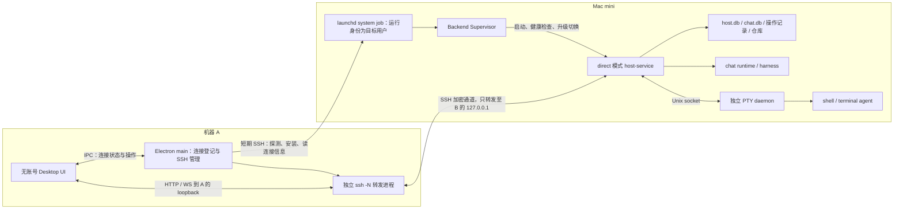

# Superset SSH 直连与自动安装守护后端设计

- 状态：设计提案，已经过源码对照和静态自审；尚未实现。
- 日期：2026-10-10。
- 源码基线：`4444zyf/superset@4ec5b6e287d380480a71b4b2ad98976354c82d4f`。
- 前置材料：[账号、远程主机与会话现状](../current-state-accounts-remote-sessions.md)。
- 复核记录：[设计复核](ssh-direct-backend-review.md)。
- 本次交付仅为设计与复核文档，不修改应用代码，不安装或操作用户的 Mac mini。

## 1. 目标与核心决定

机器 A 安装客户端后，无需注册或登录 Superset；用户添加 Mac mini 的 SSH 连接，客户端自动探测环境、上传完整后端发行包、安装并启动守护服务。随后能在 Mac mini 上添加代码项目、创建独立会话或项目 workspace、运行终端/chat agent。退出或强制关闭 A 的客户端后，B 上的任务继续执行；再次打开 A 可以连接回同一执行资源。

**采用：系统 OpenSSH 的 TCP 转发 + Mac mini 上由 launchd 管理的独立后端 + 现有 host-service/PTY/chat 核心。**

| 决策 | 具体内容 |
| --- | --- |
| SSH 的职责 | 认证操作系统用户、探测/安装后端、获取连接信息，以及转发数据流。 |
| 后端的职责 | 独立持有 workspace、任务、终端、聊天和文件操作；不以 SSH 会话或客户端 PID 作为存活条件。 |
| 业务传输 | 继续使用 HTTP/tRPC 和 WebSocket，经 SSH 转发到远端 loopback；不另造 SSH stdio 业务协议。 |
| Mac mini 服务托管 | 默认安装 system LaunchDaemon，运行进程使用 SSH 登录的普通用户身份；一次管理员安装后支持无 GUI 登录。 |
| 身份 | SSH 的 OS 用户授权 + 主机本地 PSK；没有 Superset 用户、组织成员、JWT 或远端主机名册。 |
| 数据 | B 上的 SQLite、仓库目录和 PTY daemon 是执行资源的来源；A 保存连接配置与客户端状态。 |
| 云端依赖 | 核心启动/项目/会话/运行/重连链不访问 Superset 官方 API、relay、账号、feature flag 或订阅服务。 |
| 更新 | A 上传已验证的版本；后端在允许的维护窗口切换，活跃聊天任务阻止默认升级重启。 |

Git/agent 仍可能访问 GitHub、模型供应商等第三方服务。去掉的是 Superset 的账号和官方服务依赖，不是取消这些供应商自己的认证。

### 1.1 首版边界

- B：受支持 macOS 版本的 Mac mini，原生 arm64 或 x64；Remote Login 已启用且 A 能连到其 SSH 端口。客户端不能通过尚不可达的 SSH 自动开启 Remote Login，也不提供穿透 NAT 的 relay。
- A：Electron 客户端；系统 OpenSSH 可用。macOS、Linux、Windows 使用相同连接契约，Windows 的进程回收和凭据交互分别适配；不能因 POSIX ControlMaster 路径而默认 Windows 可用。
- 默认认证为已有 SSH config/私钥/系统 ssh-agent；加密私钥解锁通过系统 agent 或受控交互处理。SSH 密码及 keyboard-interactive 作为后续认证适配，界面不能把不支持的方法显示成可用。
- 自动安装范围是后端、Node、原生依赖和 agent 适配器。模型 CLI 与登录单独检测；缺失时提供明确的安装/认证入口，不假设用户安装 A 就已具备 B 的模型凭据。
- 后端服务可在 Mac 重启后自动启动，但**重启前的进程不会无损继续**；FileVault 解锁及机器睡眠也限制实际运行。承诺的是 A 关闭/SSH 断开后继续，不把它扩展为 B 断电后仍保持执行。
- 首版保留代码项目、独立会话、终端、chat、文件/Git 和远端端口访问。团队成员、官方云任务项目、cloud sandbox、官方自动化/托管 MCP 等入口从此客户端移除；第三方可选集成按实际凭据独立启用。

## 2. 架构与进程所有权



“短期 SSH”的箭头表示客户端调用安装/控制工具，不表示 SSH 进程直接成为守护服务的父进程。服务最终由 launchd 启动，标准输入关闭，输出写远端轮转日志。

服务应满足以下不变量：

1. A 的 renderer、Electron、ssh 进程均不拥有 B 的 agent 生命周期。
2. B 的服务不设置 A 的 `HOST_PARENT_PID`，不依赖 SSH stdin、TTY、连接数或 heartbeat 才保持运行。
3. A 的退出、断开、移除本地连接只销毁本地转发和订阅；停止远端 agent 是独立的显式动作。
4. host-service HTTP 仅监听 B 的 `127.0.0.1`；PTY socket 保持用户私有。
5. 每个 B 的 OS 用户/数据 namespace 同一时间只有一个服务写其数据库、一个 daemon 持有该 namespace 的 PTY。
6. chat agent 在 B 的 host-service 中运行，因此 A 离开不停止 host-service；正常升级必须考虑活跃 chat。

现有代码已将 PTY 与客户端连接分离，但普通 Desktop 退出会停止自己拥有的本机 host-service，并 dispose chat。这是必须更改启动/所有权路径的原因。[退出清理][quit]、[终端断连][terminal-close]、[chat 清理][chat-dispose]

## 3. 客户端使用流程

### 3.1 首次连接

1. A 首次启动直接进入工作区，展示“本机”和“添加 SSH 主机”，没有 Superset 登录/组织创建页。
2. 用户填写连接名和 SSH alias，或 hostname、端口、用户名、密钥；“测试并连接”先完成 SSH 主机密钥检查与 OS 用户认证。
3. 探测 B 的 OS/架构、UID、真实 home、可用空间、已安装服务及后端版本。
4. 如果尚未安装，A 选择匹配 B 的发行包，验证、上传并安装。完整常驻模式需要一次 Mac mini 管理员认证；这一步展示服务将以哪个普通用户运行。
5. 安装完成，由 launchd 启动 supervisor/host-service；A 读取连接 manifest，建立转发并做实际健康检查。
6. 展示“已连接”，列出 B 的代码项目、会话与 agent 可用状态。之后添加项目和创建会话默认在当前选中的主机执行。

“已连接”不是只凭 ssh 进程启动成功或端口存在。必须收到预期 backendId、namespace、direct 模式和协议版本的已认证响应。

### 3.2 创建项目和会话

- 新建/clone/import 代码项目的弹窗增加目标主机；所有路径均在目标主机解释。
- 选择 B 时通过后端文件接口浏览 B 的目录，不能调用 A 的 Electron 目录选择器。保留手填路径作为可用入口。
- 新建 project-less session 使用 B 的 sessionsRoot；创建 project workspace 使用 B 的 repoPath/worktreeBaseDir。
- agent 配置、CLI、模型认证和执行 cwd 都属于 B。创建结果返回稳定的 workspace/terminal/chat 标识。
- 项目创建仍复用 `project.create` 和 `project.setup` 的业务逻辑；传输和 UI 的本机绑定需要调整。[现有项目 API][project]、[本机 clone 弹窗][project-ui]、[session 创建][session-create]

### 3.3 退出和重连

退出 A：关闭 A 的 WS、文件监听和 ssh 转发进程，保留连接配置；不发送远端 stop/cancel/terminal.dispose，不卸载服务。

重新打开 A：连接 SSH → 查询已有服务 → 建立新转发 → 协议/身份校验 → 拉取项目、workspace、终端和 chat 当前状态 → 重新 attach。只发现服务不可用时才尝试启动/修复，不在每次连接时重新安装或重置密钥。

服务目录中的运行状态与客户端缓存冲突时，以 B 的已认证响应为准。A 关闭时可能未收到某次创建成功响应，必须查操作结果，不重新发送一份新建/启动命令。

## 4. SSH 连接与业务传输

### 4.1 采用系统 OpenSSH

首版复用操作系统的 ssh、SFTP、SSH config、ProxyJump、已验证 known_hosts 和 agent。远程命令仅用于安装/控制；长连接通过 `ssh -N -T` 转发。

选择它的原因是用户已有 SSH 认证和跳板配置能直接生效，并避免客户端自行实现 SSH 密钥、握手和跳板语义。代价是 A 需要 OpenSSH，且进程及交互必须做平台适配。

- Electron main 用 argv 方式启动程序；用户提供的 host/alias 不拼接到本地 shell，拒绝以 option 形式注入目的地址。
- 安装脚本是固定内容；远端路径、UID 和其他参数通过验证过的 JSON/数据文件传递，不能直接插值到远端 shell。
- 上传优先用同一套有效 SSH 配置的 SFTP；只有其子系统不可用才提供明确的受控兼容路径。
- 首次主机密钥需要用户确认，变更后停止并提示核查；不使用 `StrictHostKeyChecking=no` 或删除旧记录“自动修复”。
- 不在首版使用 ControlMaster；连接管理器自己复用一条转发并按窗口计数，避免关闭别的 SSH master，也减少 Windows 差异。
- 转发设置覆盖 `ControlMaster/ControlPath` 的继承；不让 A 的代理转发成为 B 后台 Git/模型认证的来源。

隧道逻辑形式为：

```text
A 127.0.0.1:<临时端口>
    → OpenSSH -N -T 的本地转发
    → B 127.0.0.1:<已认证 manifest 给出的服务端口>
```

设置 `ExitOnForwardFailure=yes` 和 SSH keepalive；keepalive 超时只判定连接失效，不向 B 发停止任务命令。

### 4.2 endpoint 与重连状态机

```text
disconnected → authenticating → probing
             → installing（仅缺失/明确更新时）
             → forwarding → verifying → ready
ready → reconnecting → probing → forwarding → verifying → ready
主机密钥变化 / 权限失败 / 协议不兼容 → blocked（需要明确修复）
```

每个连接维护 `connectionId + generation`；A 的临时端口不是永久 hostId。backendId 及 namespaceId 由 B 持久生成，客户端保存期望值；新的地址命中另一后端时不能把旧 tab/cache 直接挂过去。

- B 用端口 0 原子绑定，成功后写真实端口至 owner-only manifest；重启后端口可以变化。
- A 的转发端口选取后若 bind 竞争失败，选择新端口重试。SSH forward 成功后还需验证服务身份/健康，不能将端口 bind 当成 B 服务可用。
- 转发断开立即撤销对应 endpoint lease、清除秘密映射、关闭旧 WS 和只适用于旧 generation 的 client。
- tRPC client 按连接及 generation 缓存，不仅按 URL；查询缓存按稳定的 backendId/namespace/resource 标识保存。
- 单纯网络失败按有上限的退避重连；主机密钥变化和认证失败不无限重试。

当前 `resolveHostUrl` 将远端拼成 relay 地址，[地址选择][host-url]需要替换为连接 registry 给出的已验证 endpoint；Direct 认证策略缺少 PSK 时直接失败，不回退 `getJwt()`。

### 4.3 覆盖所有数据通道

| 功能 | 直连路径 |
| --- | --- |
| 项目/workspace/Git/文件调用 | 既有 host-service HTTP/tRPC，经同一 SSH 转发。 |
| 终端、主机事件、文件变化 | 对应 WS，经同一转发。 |
| 内置 chat | `/chat-v3/trpc` 与 stream，经同一转发。 |
| 附件 | 上传到 B 的后端附件存储，返回 B 的 attachmentId；不能留下 A 的本地文件路径。 |
| 浏览远端开发服务器 | 复用 B 的 `/fwd` mux，经现有 SSH 连接，A 建立本机浏览端口；加入 direct ForwardTransport。 |
| 本机专属 GUI/browser bridge | 有明确 capability 才启用；不能将 A 的 loopback bridge 地址当成 B 能访问的接口。 |

`/fwd` 已有主机 loopback 转发能力，可复用其 workspace 端口范围约束。[forward mux][forward-mux]。A 退出后网页访问中断，但 B 上的开发服务器终端继续运行。

## 5. 自动安装与发行包

### 5.1 完整、按架构的后端发行物

A 从本 fork 的发布渠道获取并缓存 B 对应的包；也支持选用本地离线包。运行时不要求 B 下载官方 Superset installer，不要求 B 安装 Homebrew、Bun、npm 或编译工具。

必须包含：

| 内容 | 用途 |
| --- | --- |
| 固定版本 Node runtime | supervisor、host-service、PTY daemon 的生产运行时。 |
| supervisor 与 direct host-service bundle | 常驻管理和无云端服务启动。 |
| `host-worker.js`、`pty-daemon.js` | worker/native PTY 运行与重启后 adoption。 |
| 完整原生包和 JS wrapper | better-sqlite3、node-pty、@parcel/watcher 等；匹配 darwin 架构与所打包 Node ABI。 |
| host/chat migrations | 离线初始化及升级 SQLite。 |
| agent 适配器、shell hook 模板 | 终端通知与本机 agent 集成；剔除默认依赖官方 API 的 hosted MCP 配置。 |
| 固定安装/控制工具 | 服务登记、manifest 查询、修复与卸载。 |
| 签名发布 manifest | 文件摘要、版本、平台、最低 OS、协议与 schema 兼容信息。 |

现有 CLI 发行脚本已经打包 Node、原生包、worker、PTY、migrations 和模板；应抽取并复用它的后端打包能力，而非只上传 `host-service.js`。[现有 build-dist][build-dist]、[host build][host-build]

Node 版本在发行时固定到受支持 LTS，并与原生依赖一起构建/验证；当前源码中的 Node 版本只是现状，不能将“用 A 的 Node 能跑”作为 B 包的验证。

A 验证签名和摘要后上传，B 的安装器重新验证 payload、限制解包路径并检查架构。不能只把摘要文件和包从同一个任意地址下载就视作已建立可信来源；客户端内置本 fork 的发布验证公钥。签名/公证流程在实际发布实现，不在本次文档任务中执行。

### 5.2 安装事务

```text
probe → acquire install lock → upload .partial → verify
      → stage complete release → register service → start
      → authenticated health + native PTY smoke → committed
```

- 特权安装器持有系统安装级锁，串行写入共享的 root-owned release/launcher 与 job 登记；另有 UID/namespace 级安装、运行和维护锁，避免多窗口或两台 A 创建重复服务、并发迁移同一 DB。锁顺序固定为系统安装锁 → namespace 安装/维护锁，正常运行锁不阻塞给其他 UID 安装发行物。
- release 目录按版本和内容摘要不可变发布，已安装的可信目录可复用；某 UID 的升级不能改写其他 UID 正在执行的程序或停止其 job。现有安装锁也强调所有安装写入者共享锁，但其普通用户自更新方式不适用于新的 root-owned 目录。[现有安装锁][install-lock]
- 文件完整前不切换当前版本；上传失败仅留下可回收 .partial，已运行的旧版本不受影响。
- 安装 journal 记录阶段、installId、版本和错误；下一次连接能判断已完成、可继续或需清理。
- 可按阶段取消；提交后即使 A 退出，也由 launchd 启动并由 supervisor 完成健康确认。
- 如果新建 job 失败，回收本次创建的临时 job/文件，保留数据和原有可用版本。不得停止官方 Superset 已运行的服务来占用端口。
- 后端“已安装且健康”与“所选 agent 已认证”分开显示；后者未满足时不能把创建 agent 的失败伪装成安装失败。

### 5.3 安装路径与权限

以下为新发行产品的建议路径，独立于现有官方安装：

```text
/Library/Application Support/SupersetDirect/
  runtime/<release>/...                 # root-owned 已验证发行物
  launcher/...                         # root-owned 固定 supervisor 启动器
/Library/LaunchDaemons/
  io.superset.direct.backend.<uid>.plist

<目标用户 home>/.superset-direct/
  identity.json                        # backendId、namespaceId；不含 Superset 账号
  service-config.json                  # 允许的版本、数据路径
  credentials/host-secret              # 32-byte 随机 PSK，0600
  state/install-journal.json
  state/version.json
  state/endpoint.json                  # PID、instanceId、端口；非真实性凭据
  host/<namespaceId>/host.db
  host/<namespaceId>/chat.db
  sessions/
  logs/
```

系统 plist/启动器只能指向受控的 root-owned 程序，数据、日志和仓库归目标用户；配置中的路径均校验，不把任意待执行命令当成升级参数。supervisor 和 agent 都以普通用户运行，host-service API 不拥有提权或任意 root 命令能力。

PTY Unix socket 沿用短路径散列和私有权限，避免 macOS sun_path 长度上限；namespace 与新 home 同时参与隔离。[daemon socket][daemon-socket]

现有 sessionsRoot 写死为 `homedir()/.superset/sessions`；仅设置 `SUPERSET_HOME_DIR` 并不能完成隔离，需要统一数据路径解析。[现有 session 路径][session-path]

## 6. Mac mini 的常驻机制

### 6.1 默认：system LaunchDaemon，以目标用户运行

| launchd 配置 | 设计要求 |
| --- | --- |
| Label | 每 UID 一个固定且与旧应用隔离的标识。 |
| ProgramArguments | root-owned 固定 Node/启动器，参数是已校验的配置路径。 |
| UserName / GroupName | SSH 登录的非 root 用户及其有效组，运行仓库、Git、agent 的实际身份。 |
| RunAtLoad / KeepAlive | 启动并由 launchd 托管 supervisor；设置重启节流。 |
| WorkingDirectory / 环境 | 使用真实目标 home 与受控 PATH，明确运行 home；不依赖安装时 SSH 的临时环境。 |
| 标准流 | stdin 不连接 SSH；stdout/stderr 进入有大小上限的本机日志。 |
| AbandonProcessGroup | 明确保留独立 PTY 进程组，配合 supervisor 的清理策略；真实 macOS 验证必须确认 job 重启/bootout 对 daemon 的影响。 |

Apple 文档明确区分 system daemon 与用户登录时启动的 agent，并提供以指定用户运行的配置机制。[launchd 文档][apple-launchd]

安装系统 job 需要管理员权限。客户端通过已认证 SSH 的专用安装通道处理临时授权，凭据不进入 argv、日志或持久配置；首版按固定安装器/签名包操作，不执行用户输入的任意提权命令。仅在需要安装/升级系统发行物、服务登记或卸载时提权，正常连接和使用不需要。

如果 SSH 用户没有相应权限，不能宣称后台完整安装成功：显示明确的管理员安装要求，或者让用户选择下面的受限模式。首次远端管理员交互是未来产品流程的一部分，本次只设计，不请求或使用任何凭据。

### 6.2 可选：用户 LaunchAgent

针对没有管理员权限、且 Mac mini 已有该用户 GUI 登录会话的场景，可安装用户 LaunchAgent，不需要 system job。

该模式仍能在 A 退出后运行，但 **B 用户退出登录或无相应登录 domain 时不满足无人值守保证**。探测 domain 后才提供；不能把 SSH 的后台 `nohup` 或对未知 `user/<uid>` 的 bootstrap 当成等价、可靠的默认实现。

首版完整验收以 system LaunchDaemon 为准。若 GUI 登录相关 Keychain/TCC 能力只能在用户域工作，作为显式受限 profile 处理，不悄悄切换生命周期承诺。

### 6.3 Backend Supervisor

新增轻量 supervisor，不重复实现业务 API。它负责：

- 获得并持有 namespace 级运行锁，验证配置与已安装 release。
- 启动 direct host-service，等待完整健康；服务写自己的 `instanceId/endpoint`，supervisor 核验而非信任任意 PID 文件。
- 异常退出退避重启；连续启动失败进入受控故障状态，不无限高速重启。
- 探测并采用同 namespace 的已有 PTY daemon；正常 host-service 重启不主动停止 daemon。
- direct 模式不能照搬现有 trustd healing、开发模式替换或版本漂移自动重启所含的破坏性分支。已有代码的 `killAdoptedDaemon` 会丢失 PTY 会话；有活跃任务时只报告降级并延后维护，首次启动前检查环境，确需重启时显式确认影响。[现有 daemon 终止路径][daemon-healing]
- 在升级时执行停接新任务、健康确认、版本切换与回滚。
- 保持简短控制/诊断通道，让 SSH 安装工具能查询启动失败原因。
- 显式停止/卸载时才按约定停止该产品实例的 agent 与 daemon。

不将旧的 Desktop coordinator 直接挪到 B：它含 Electron 耦合、账号 reconcile、父进程 watchdog 和 quit 所有权；复用其可分离的健康/manifest 思路，不复用这些生命周期条件。

### 6.4 后台凭据与 macOS 环境

launchd 环境不同于 GUI/SSH 登录 shell。PATH、shell、Git、agent 可执行路径需要解析并验证；包内 Node 与原生依赖不走用户 PATH。

B 的 Git/模型请求使用 B 可在后台访问的凭据。A 的 SSH_AUTH_SOCK 转发在 A 关闭后会失效，所以不能作为持续任务的默认认证来源。模型 CLI 的登录采用供应商支持的远程/device flow；必要的 callback 可以由单独 SSH 转发处理，不自动复制 A 的模型 token。

现有 daemon 代码专门处理 macOS trustd 不可达，这说明“能启动进程”不足以证明系统 daemon 环境可用。[trustd 处理][trustd]。必须在 system job 实际上下文验证 HTTPS、Git、PTY 和所选 CLI；Keychain 锁定、TCC/GUI 专属操作不能声称必然可用。首版不承诺 headless agent 操作受保护的 GUI。

## 7. 去账号与官方服务依赖

### 7.1 客户端改造

| 当前耦合 | 目标替换 |
| --- | --- |
| AuthProvider / authenticated layout / onboarding 的登录与组织准入 | 无账号 workstation root，仅按本机设置和后端连接状态进入 UI。 |
| Superset 用户、活动组织与 org 切换 | 本机 profile + 当前 Connection；namespace 只做本地数据隔离。 |
| useKnownHosts 的 cloud roster / relay presence | Electron main 的 SQLite ConnectionRegistry + 已认证服务健康与 SSH 状态。 |
| JWT 缓存、刷新、getRelayUrl、账号登出事件 | Direct Connection 的 PSK 策略；移除对应官方服务请求和生命周期回调。 |
| 云 collection 与组织 localStorage 状态 | 连接 registry 用 SQLite；host 数据通过直连查询/事件汇总；有限 UI singleton 才留 localStorage。 |
| 云 feature flags / Paywall / 订阅 / 团队入口 | 本地 capability/设置；移除无后端支撑的入口。 |
| 官方 notices、自动升级和 telemetry | 核心启动不加载；更新仅走本 fork 发布渠道，断网不阻塞启动。 |

新客户端的 Superset 用户不存在，不用 mock session、虚假 JWT 或 `SKIP_ENV_VALIDATION` 绕过认证。模型账号和 SSH 身份可以显示在主机设置中，但不重新构造“Superset 注册/成员权限”体系。

主机业务数据库不由 renderer 的无上限 localStorage 代管；实体缓存和连接配置遵循仓库的 SQLite/容量规则。

### 7.2 后端增加真正的 direct 启动路径

当前 env 要求 `AUTH_TOKEN`、`ORGANIZATION_ID`、`SUPERSET_API_URL`；`createApp` 创建云 ApiClient，page watch 等后台功能也依赖它。旧的 `system.update` 还调用云端 owner 授权。[env][host-env]、[app 构造][host-app]、[system update][system-update]

新增专用 direct entry/config，将本地 core 与 CloudServices 拆开：

- local core：SQLite、workspace/project、文件/Git、终端、agent、chat、事件和 direct PSK。
- direct 模式完全不构造云 JWT provider、relay tunnel、云 API client、page watch、cloud task 同步或官方托管 MCP。
- GitHub/PR 功能可使用 B 自有 `gh`/Git 凭据；可选功能不可用返回 capability 错误，不能隐式请求官方服务。
- workspace 创建中的云 task 查询/启动、trackCreated、analytics 改为可选功能/本地事件，不能留下阻塞或反复失败的请求。
- 本地清理、归档、恢复等依赖 ctx.api 的函数要逐个审查并抽出本地路径；不是给 ApiClient 塞一个“所有方法都成功”的空对象。
- direct 的服务重启/升级由 supervisor 和本地 PSK/SSH 的 OS 权限负责，不复用 cloud owner 授权。
- host/core 的类型和构建入口不在模块导入时加载云 env 校验；干净环境中只有 direct 配置也能启动。

运行 namespace 用随机持久 UUID，属于 B 的本地目录隔离。兼容阶段允许旧组织字段在适配层表示 legacy 数据 namespace，但不拿它去声称组织成员资格或发云请求；新契约明确 `namespaceId`。新记录的 actor 使用本机 clientId/标签做审计，服务端不据客户端声明授予权限。

### 7.3 认证与秘密

- B 首次安装生成独立 PSK，保存在目标用户私有文件；重连不重新生成。
- A 每次经过已验证 SSH，以目标 OS 用户读取连接材料；PSK 仅保存在本次连接的内存/安全 IPC，不写 renderer localStorage。
- HTTP 用 Bearer PSK，WS 在现有 token 方式下必须擦除日志里的 token/query；实现时优先由 main 的 transport 代理秘密，允许受控 renderer 内存兼容。
- local HTTP/WS 保留认证与 origin 约束；不因为“经过 SSH/loopback”就开放匿名接口。
- 不按连接数/PSK 到期停止已有任务。密钥轮换只改变新请求与连接授权，正常重连可重新通过 SSH 获取。
- 同一 B OS 用户可以由多台 A 连接，拥有同一执行空间；clientId 是观察/审计标签，不是强权限主体。首版单用户模型不提供不同 Superset 成员的 ACL。
- 拥有该 OS 用户的 SSH 执行权限，本来就能读其文件/执行命令；SSH key 撤销及存量连接断开由 OS 管理，不宣传共享 PSK 是可独立撤销的多租户身份。

## 8. 数据、RPC 和操作可靠性

### 8.1 稳定身份与连接配置

A 的 SQLite 保存：connectionId、名称、SSH alias/目标参数、有效认证配置引用、期望 backendId/namespaceId、最后已知版本和状态时间。不要持久化 SSH 密码、PSK 或私钥正文。

B 持久保存：backendId、namespaceId、schema 版本、操作日志、项目/workspace、terminal/agent 绑定、chat journal。hostId 不再从官方名册获得；遗留 machineId 用于迁移匹配，不能仅凭 hostname 或一个临时转发端口识别主机。

资源定位包含 `backendId + namespaceId + resourceId`。保留 resourceId，避免 tab、Git 路径和 agent session 映射漂移；需要汇总同一个项目在多主机的副本时由明确关联表达，不靠账号组织名猜测。

### 8.2 新增能力协商

以下是拟新增契约，不是当前接口：

```text
direct.describe:
  backendId, namespaceId, instanceId, runtimeMode="direct"
  protocolVersion, minimumClientVersion, dataSchemaVersion
  capabilities: projects, sessions, terminal, chatHarnesses,
                filesystem, attachments, forwardMux, operations,
                lifecycleControl, updateDrain
  serviceUser, platform, architecture
```

既有业务 tRPC 过程能复用时保持其输入/行为；新 procedure/字段采用 additive 演进。客户端在使用前检查 capability，旧主机缺失新过程时提示兼容更新，不默默回退官方 relay。direct mode 不连接未改造的旧官方 host-service，不能只替换 URL 就称其兼容。

### 8.3 幂等接受与重连恢复

SSH 断开可能发生在“B 已执行、A 未收到结果”之间。A 对创建/启动/发送 chat prompt 持久保存 operationId 和输入摘要，B 提供持久 operations 表/查询，记录接受、执行阶段、实体 ID 与结果。

- 同一个 operationId 和相同输入返回同一状态；同 ID 不同输入拒绝。
- 创建会话先记录 workspace ID；启动终端先记录 terminal ID，再与 daemon open/list 对账。故障恢复可以确认已存在的执行资源，不能盲目再起一个 agent。
- chat prompt 的去重记录要与 durable journal 接受关联，不能依靠当前内存 CommandDedupe；当前实现的缓存会在 host-service 重启后丢失。[chat 去重][chat-dedupe]
- 对操作结果尚不明确的请求先查询；不重放 terminal keystroke、已接受 prompt 或有副作用的命令。
- 记录并展示 accepted/running/succeeded/failed/interrupted；“workspace 已创建但 agent 未成功启动”必须保留可修复的分阶段状态。
- 去重结果和缓存有保留期限；期限之外的未确认请求只查询或由用户明确重新发起，不自动再执行。
- 只承诺操作接受与资源分配的幂等，不承诺模型/工具在外部系统的副作用“恰好一次”。

现有 createSession 的 workspace UUID 去重可作为基础，但返回已有 row 不代表其 agent 一定已经启动；需要上述阶段和结果记录。[session 创建][session-create]。现有 enqueue 是 host-service 内的 Promise，需要纳入 operations 的恢复策略，而非将它当成持久任务队列。

### 8.4 正常重连与后端故障

| 事件 | 处理 |
| --- | --- |
| A 退出 / SSH 暂断 | B 不停止。A 后续读当前列表、操作结果，再 attach；chat 使用 journal cursor 回放。 |
| host-service 异常退出 | supervisor 重启；PTY daemon 存活则 adopt，同一 terminal ID 不重复 launch。 |
| chat host-service 丢失 | 把缺少 live runtime 的运行 turn 标记 interrupted，保留历史和 agent session ID；允许供应商支持的明确 resume，不伪装成同一活进程。 |
| PTY daemon 死亡 | 进程已丢失；保留绑定/历史，显示中断。若已有 agent resume 能力，只恢复会话上下文，不能承诺无损继续工具动作。 |
| B 重启/睡眠 | 重启后服务恢复并对账；原进程标记中断。睡眠时暂停计算，恢复后重连；不修改用户电源设置来掩盖此限制。 |
| 有审批/输入等待 | 无连接时继续保留 waiting，不自动批准；A 重连后恢复操作入口。 |

终端 ring buffer 默认仅约 64 KiB，重连不保证包含断开期间的所有输出；首版保留该边界并提供 agent transcript 可用信息，不把无限历史列为持续运行的前提。

## 9. 升级、修复和卸载

### 9.1 升级策略

下载、安装新 release 和激活新 release 分开；已验证且 root-owned 的候选版本可以先装好，当前版本继续运行。direct 模式关闭现有官方 CLI 自更新逻辑。

激活流程：

1. namespace 级维护锁；校验协议、schema、原生 ABI 和 daemon 协议。
2. 进入 drain：拒绝新建 agent、chat prompt 和新 create job，仍可读状态、处理已有任务所需输入/审批。重新检查活跃 chat/queued turn/等待审批及 create job，避免多客户端在检查后又启动任务。
3. 默认等待这些操作结束；没有可中断的静默超时。A 离开可撤销尚未获完整授权的升级；已经提交的安装/激活由 supervisor 的 durable 状态处理。
4. 持有数据写入边界并做 SQLite 一致性备份，停止旧 host-service，切换候选版本；terminal PTY daemon 保持运行。
5. 运行 migrations，启动新 host-service，校验版本/身份/健康和 daemon adoption。
6. 健康通过后标记 committed；失败则按下面的 schema 规则回滚。

用户明确选择强制激活时先报告会中断哪些 chat/创建操作并保存状态，不能把它作为普通“检查更新”的副作用。daemon 的 fd-handoff 仅在版本/协议支持且验证通过时使用；无法无损更新的 daemon 延后到终端任务完成。

### 9.2 回滚边界

不能只切回旧 binary 就声称 schema 已回滚：

- additive 且旧代码可读的 migration：回退旧 binary，保留兼容数据。
- 不兼容 migration：必须在维护锁、无新写入/任务启动的条件下恢复一致性备份，或明确拒绝自动激活，要求停机迁移。
- 候选版本健康确认前不开放业务写入；新版本已接受用户写入后不能静默恢复旧备份丢弃这些写入。
- 维护模式同时禁止候选启动触发的后台清理、归档 reconcile、provider 文件改写、hooks 和自动任务恢复。现有 `createApp` 在启动后立即调度这些后台操作；删除 worktree 等外部副作用无法靠恢复 SQLite 撤销。候选的健康检查仅验证控制面、只读能力及可清理的隔离 PTY；迁移限于可回滚的数据边界，提交后才开放正常后台任务。[现有启动 sweep][startup-sweeps]
- 升级失败不会触发 terminal daemon kill。运行目录和旧版本保留到回滚窗口结束，日志/包缓存有容量上限。

supervisor 是独立稳定入口，不随本次 host-service release 的切换消失；它需要自身更新时只能用相应维护路径处理。

### 9.3 控制语义

| UI 动作 | 语义 |
| --- | --- |
| 断开主机 / 移除 A 的连接 | 关闭 A 的转发、删除本地连接项；保留 B 的服务与所有任务。 |
| 关闭某终端 / 取消某 agent | 明确指向单个资源的远端停止。 |
| 停止远端后端 | 先说明对 chat/PTY 的影响，持久置为停用并停止该实例；不能因 KeepAlive 立即自动复活。 |
| 修复安装 | 校验当前实例，只修复受控程序/服务登记；不重置 PSK、删除 DB 或抢占旧应用实例。 |
| 卸载远端后端 | 通过 SSH 安装器停服务并移除自己的 job/程序；数据默认保留，删除数据另行选择。 |

停止状态由 supervisor 持久执行；launchd 即使重启 supervisor，也不会自动恢复被用户显式停用的 workload。卸载 system job 需要管理员权限。A 的 Quit Completely 只能对本机 owned 实例执行完全清理，不能遍历 ConnectionRegistry 停掉所有 B。

## 10. 既有数据的迁移与共存

- 默认新 home、新 namespace、新 launchd label，不采用或停止现有官方 daemon，不同时写它的 DB。
- 提供单独的“导入本机已有数据”：扫描该 OS 用户可读的本地 DB/仓库及 v1 状态，不登录云端来推导主机列表。
- 导入前停止相关写入、做 SQLite 一致性备份；活动 agent 先在旧实例完成，不把跨 namespace 进程转交作为首版承诺。
- 复制项目/workspace 元数据并保留 UUID、真实 repoPath/worktreePath、旧 actor 与 agent session ID；不擅自移动/删除仓库。
- 旧组织目录显式映射到导入 namespace；若多份 DB 的项目/ID/路径冲突，展示冲突并分 namespace，不全量合并覆盖。
- DB 中“active”但新 namespace 中没有活进程的终端/chat 标记 interrupted；旧历史和可恢复上下文保留。
- 旧配置里官方 MCP/账号 token 不复制到新 direct runtime；第三方模型配置由用户明确选择并验证后台可用性。
- importer 写迁移 journal，失败回退新目录，源数据保持不变。切回旧应用不要求撤销新产品的数据。

## 11. 实施落点与分阶段交付

以下是后续实现范围，本次没有执行。

| 区域 | 实施内容 |
| --- | --- |
| Desktop root/providers、CollectionsProvider | 去登录/组织/云准入；建立 workstation、ConnectionRegistry 和 capability 驱动。 |
| Electron main 新 SSH/安装模块 | OS SSH 进程、配置、host key 交互、SFTP、安装事务、endpoint lease、退出回收。 |
| useKnownHosts / useHostTargetUrl / host-service-auth | 用本地 registry 与 direct PSK 取代 cloud roster、relay 地址和 JWT fallback。 |
| NewProjectModal / EmptyProjectModal / SetupProjectModal | 目标机器选择、远端目录操作和错误提示。 |
| workspace-creates / terminal/chat transport | generation 与稳定主机 identity、操作结果查询、禁止断连重放副作用。 |
| host-service direct entry / app / types / env | 拆 local core 与云功能；独立配置、身份、后台初始化/清理路径。 |
| daemon supervision / data paths | namespace 隔离、PTY adoption、显式停止和 direct 模式升级策略。 |
| new backend supervisor / installer | launchd 管理、普通用户执行、运行/安装锁、健康和版本事务。 |
| CLI build-dist / 发布流程 | 抽取完整后端包、双架构构建、签名与摘要、离线安装。 |
| local-db / host-db / chat journal | 连接与操作状态、迁移记录、持久去重、容量/保留策略。 |
| port-forward / agent provisioning | direct mux、供应商凭据验证、移除默认官方托管 MCP。 |

建议依赖顺序：

1. **无账号本机闭环**：direct entry 和客户端根路由；干净环境在断开官方服务后仍能创建项目、session 和终端/chat。
2. **SSH 已安装主机闭环**：registry、identity/capability、完整 HTTP/WS 传输及 remote project UI；仅用于中间验证，不能当成最终交付。
3. **自动安装与常驻**：完整双架构包、system launchd、supervisor、安装事务；真实两机关闭 A 验证。
4. **故障恢复与维护**：持久 operations、chat 中断对账、升级/drain/回滚、数据导入和显式停止。
5. **发布验收**：所有下面的核心场景通过后，才宣称“安装 A 后经 SSH 自动部署并持续运行”完成。

## 12. 验收与可证明范围

设计成立不等于已经通过运行验证。后续至少需要：

| 编号 | 验收场景 | 必须观察的结果 |
| --- | --- | --- |
| A01 | 全新 A、无 Superset token/组织环境，官方域名不可达 | 启动不要求登录，不发官方网络请求，进入本机/SSH 工作区。 |
| A02 | B 无 Node/Bun/Homebrew 和 Superset 后端 | A 经 SSH 自动安装全部依赖、登记 job、已认证健康及真实 PTY I/O 成功。 |
| A03 | B 无 GUI 登录，system job 使用普通用户 | UID/home 正确、文件可写、HTTPS/Git/所选已认证 CLI 在真实 daemon 上下文可用。 |
| A04 | arm64 和 x64 Mac mini | 对应发行包运行原生 SQLite、PTY、watcher、worker 和 chat migrations。 |
| A05 | B 上 clone/import 项目和创建独立 session | 仓库、目录、DB、agent PID/cwd 都位于 B；A 无错误的本地目录副本。 |
| A06 | 终端 agent 运行中，先普通退出再强制杀死 A | B 同一 PID/terminal ID 继续输出，任务后续完成，A 重开可 attach。 |
| A07 | chat turn 运行中关闭 A | B 的 host-service/harness 不退出，turn 继续；重连回放同一 session 的结果。 |
| A08 | SSH 暂断，B 已接受创建/prompt 但 A 丢失响应 | 重连查询同一 operation，只有一个资源/一次 prompt 接受，不重放 keystroke。 |
| A09 | host-service 崩溃后恢复，以及 trustd 降级/daemon 版本漂移 | PTY 可采用且不重复 agent，不因自动修复杀掉活跃任务；chat 真实中断被标记，历史可读。 |
| A10 | Mac 重启、睡眠/唤醒、用户 logout | 各 profile 按承诺恢复/降级；不把重启后新 PID 说成旧进程继续。 |
| A11 | 多窗口/两台 A，以及 B 不同 OS 用户并发安装、创建和维护 | 每 namespace 只一套 writer/daemon，共享发行物不串改其他 UID 的 job/版本，幂等结果一致，无检查后启动任务的升级竞态。 |
| A12 | 端口占用/复用、地址指向不同 Mac、host key 改变 | 身份校验阻止误接与旧缓存绑定，不静默忽略主机密钥变化。 |
| A13 | 活跃 chat / 等待审批时默认升级 | 候选可安装但不激活，不取消任务；drain 和显式强制行为符合协议。 |
| A14 | 上传中断、候选启动失败、schema 不兼容 | 原版本继续或按一致性规则回滚，DB 不损坏，PTY 不被升级清理；候选维护启动不删除 worktree 或改写 provider 文件。 |
| A15 | A 断开/移除 vs 显式远端停止/卸载 | 前者保留 B；后者只操作目标实例，显式停止不会 KeepAlive 复活。 |
| A16 | 远端文件、附件、WS 和开发服务器端口访问 | 全部经 SSH，官方 relay 被阻断仍可用；A 退出只失去访问。 |

unit/integration 检查覆盖连接状态机、安装 journal、路径与权限、秘密擦除、幂等和 capability 缺失。跨机器、native macOS、launchd 与 CLI 凭据行为必须在真实 macOS 发行环境检查，Linux cloud 中的静态审查不能代替它们。

## 13. 本次复核结论

架构能在进程所有权、数据来源和网络路径上满足 A → Mac mini 的目标；当前代码具备可复用的业务与 PTY 基础，但需要真实的 direct core 拆分、完整发行物、SSH 客户端接入和 OS 服务安装，不能通过一个 relay 配置开关完成。

静态复核已把以下问题纳入最终方案：无 GUI 的 launchd 条件、一次管理员安装、chat 升级中断、原生 ABI、后台凭据、官方 API 的隐式调用、端口复用/身份、持久去重、安装锁范围、破坏性 daemon 修复以及 schema/外部副作用回滚。详见[逐项复核](ssh-direct-backend-review.md)。

这些是实施和验收条件，不是已完成的产品能力。本次未创建发布物、未执行远端安装、未运行双机或 launchd 测试。

[quit]: https://github.com/4444zyf/superset/blob/4ec5b6e287d380480a71b4b2ad98976354c82d4f/apps/desktop/src/main/lib/quit-sequence.ts#L49-L76
[terminal-close]: https://github.com/4444zyf/superset/blob/4ec5b6e287d380480a71b4b2ad98976354c82d4f/packages/host-service/src/terminal/terminal.ts#L3895-L3905
[chat-dispose]: https://github.com/4444zyf/superset/blob/4ec5b6e287d380480a71b4b2ad98976354c82d4f/packages/host-service/src/app.ts#L525-L545
[project]: https://github.com/4444zyf/superset/blob/4ec5b6e287d380480a71b4b2ad98976354c82d4f/packages/host-service/src/trpc/router/project/project.ts#L608-L675
[project-ui]: https://github.com/4444zyf/superset/blob/4ec5b6e287d380480a71b4b2ad98976354c82d4f/apps/desktop/src/renderer/routes/_authenticated/_dashboard/components/AddRepositoryModals/components/NewProjectModal/NewProjectModal.tsx#L50-L170
[session-create]: https://github.com/4444zyf/superset/blob/4ec5b6e287d380480a71b4b2ad98976354c82d4f/packages/host-service/src/trpc/router/workspace-creation/procedures/create-session.ts#L63-L215
[host-url]: https://github.com/4444zyf/superset/blob/4ec5b6e287d380480a71b4b2ad98976354c82d4f/apps/desktop/src/renderer/hooks/host-service/useHostTargetUrl/resolveHostUrl.ts#L21-L35
[forward-mux]: https://github.com/4444zyf/superset/blob/4ec5b6e287d380480a71b4b2ad98976354c82d4f/packages/host-service/src/ports/forward-mux-route.ts#L40-L69
[build-dist]: https://github.com/4444zyf/superset/blob/4ec5b6e287d380480a71b4b2ad98976354c82d4f/packages/cli/scripts/build-dist.ts#L1-L79
[host-build]: https://github.com/4444zyf/superset/blob/4ec5b6e287d380480a71b4b2ad98976354c82d4f/packages/host-service/build.ts#L1-L72
[daemon-socket]: https://github.com/4444zyf/superset/blob/4ec5b6e287d380480a71b4b2ad98976354c82d4f/packages/host-service/src/daemon/DaemonSupervisor.ts#L160-L194
[session-path]: https://github.com/4444zyf/superset/blob/4ec5b6e287d380480a71b4b2ad98976354c82d4f/packages/host-service/src/trpc/router/workspace-creation/shared/session-paths.ts#L6-L25
[trustd]: https://github.com/4444zyf/superset/blob/4ec5b6e287d380480a71b4b2ad98976354c82d4f/packages/host-service/src/daemon/DaemonSupervisor.ts#L915-L930
[host-env]: https://github.com/4444zyf/superset/blob/4ec5b6e287d380480a71b4b2ad98976354c82d4f/packages/host-service/src/env.ts#L1-L47
[host-app]: https://github.com/4444zyf/superset/blob/4ec5b6e287d380480a71b4b2ad98976354c82d4f/packages/host-service/src/app.ts#L75-L131
[system-update]: https://github.com/4444zyf/superset/blob/4ec5b6e287d380480a71b4b2ad98976354c82d4f/packages/host-service/src/trpc/router/system/system.ts#L17-L47
[chat-dedupe]: https://github.com/4444zyf/superset/blob/4ec5b6e287d380480a71b4b2ad98976354c82d4f/packages/chat-runtime/src/commands/commandDedupe/commandDedupe.ts#L1-L39
[apple-launchd]: https://developer.apple.com/library/archive/documentation/MacOSX/Conceptual/BPSystemStartup/Chapters/CreatingLaunchdJobs.html
[install-lock]: https://github.com/4444zyf/superset/blob/4ec5b6e287d380480a71b4b2ad98976354c82d4f/packages/shared/src/install-update-lock.ts#L12-L39
[daemon-healing]: https://github.com/4444zyf/superset/blob/4ec5b6e287d380480a71b4b2ad98976354c82d4f/packages/host-service/src/daemon/DaemonSupervisor.ts#L273-L304
[startup-sweeps]: https://github.com/4444zyf/superset/blob/4ec5b6e287d380480a71b4b2ad98976354c82d4f/packages/host-service/src/app.ts#L346-L404
