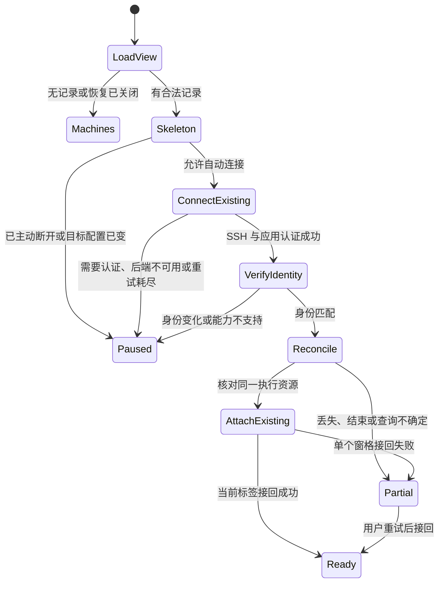

# SSH 工作窗口：关闭客户端后的布局保存与会话恢复

日期：2026-10-13。状态：已按TDD实现；Linux源码构建20样本及异常生命周期验证通过，双架构原生DMG验收进行中。实现记录见[窗口恢复验收](../implementation/ssh-workspace-window-restore-2026-10-13.md)。

研究基线：当前工作树，HEAD 为 `c6cca992663101bac0ddf43a25d108be93b1827e`。工作树中另有连接性能、归档安装和进度展示的进行中修改；本文依据阅读时的源码，不将这些修改视为已发布能力。本次只新增本文。

相关设计：[SSH 直连与后端常驻](ssh-direct-backend.md)、[连接性能与进度](ssh-connection-performance-progress.md)。现有验证范围见[实现与验收记录](../implementation/ssh-direct-backend.md)；其中客户端退出后 PTY 持续运行的证据，不等于窗口自动恢复已经实现。

## 1. 目标与产品决定

用户在本地 Superset Remix 中打开远端 Claude、Codex、OMP 三个工作窗格，退出应用；下一次打开后自动连接原来的 SSH 主机、回到原工作区，并恢复三个窗格的顺序、分屏比例和焦点。存活会话接回原执行资源，已经结束或无法确认的会话保留原位置并说明状态。

这里的“窗口”默认指一个桌面应用窗口内的工作区标签和终端/chat 窗格。首版同时补齐分屏能力，不能只保存当前单终端选择后就宣称恢复了三个工作窗口。

主要决定：

1. 默认开启“启动时恢复上次工作窗口”；只有用户曾主动成功连接、且最后未主动断开的 SSH 目标才参与自动连接。没有记录的首次启动仍进入机器列表。
2. 布局与会话引用保存在本地桌面主进程的 SQLite 中；远端持有真实任务和会话。启动先绘制布局骨架，再认证连接、核对资源、接入输出。
3. 自动恢复只能连接已有后端和已有会话；不会安装、Start、Repair、激活新 release、重启 agent、发送旧命令、恢复供应商上下文或代替用户批准工具操作。
4. 原进程仍存活时接回同一 PTY；原进程不存在时显示“已结束”或“已中断”，保留窗格，重新启动必须由用户明确操作。
5. 首版保留当前一个前台主机的连接模型：同一主机的多个工作区可保存成标签；自动连接上次前台主机，其他主机的布局保留，切换过去再连接。多个主机同时执行的任务仍由各自后端维持。
6. 不扩展为远端关机、重启、PTY daemon 死亡后的无损继续，也不承诺恢复断开期间全部终端输出。

## 2. 当前代码与缺口

| 现有行为 | 源码依据 | 本设计需要补齐的部分 |
| --- | --- | --- |
| 窗口关闭/应用退出清理客户端连接 | `direct-app.ts` 的 `closed`、`before-quit`；`SocketBroker.closeOwner` | 保留该所有权边界；退出清理不能被记录为用户主动“断开”。 |
| 每次启动从机器页开始 | `Workstation.tsx` 的 `page`、`selectedId` 使用 `useState` | 保存前台主机、已打开的工作区与标签；启动读取恢复记录。 |
| 工作区和终端选择仅在内存 | `useWorkstation.ts` 的 `workspaceId`、`terminalIds`、`terminalId` | 资源引用与选中状态需要持久化。 |
| 打开工作区查询 `terminal.list`，默认选择第一项 | `useWorkstation.selectWorkspace` | 按保存的 ID/执行实例匹配，不能以列表第一项替换原窗格。 |
| 一个工作区只展示一个选中终端，多个终端通过编号切换 | `WorkspaceEditor.tsx`、`RemoteTerminal.tsx` | 新增窗格树、工作区标签和各窗格独立状态。 |
| 网络断线后的重连表只保存在主进程内存 | `AutomaticReconnect` | 继续复用运行期重连；新增跨进程启动恢复协调器。 |
| 已认证响应带后端、namespace 和服务实例身份 | `manager.ts`、`DirectDescriptor` | 使用稳定身份绑定布局，重新取得本次连接 generation。 |
| `terminal.list` 合并 daemon 与内存视图，daemon 查询失败可能退回内存 | `listLiveTerminalSessions` | 新增能表示“不确定”的恢复资源查询，不能把失败当成空列表或确定存活。 |
| 普通终端 WS 会尝试 adopt；active DB 行丢失 PTY 后还可能 respawn | `terminal.ts` 的 `resolveSessionForAttach` | 新增严格接回接口；只在界面发起连接前查一次列表不能消除竞态。 |
| 终端回放 epoch 会在 create/adopt/respawn 时改变 | `terminal.ts` 的 `TerminalSession.epoch` | epoch 用于输出同步，不能当成 PTY 的稳定执行身份。 |
| daemon `SessionInfo` 目前只有 id/pid/尺寸/alive | `packages/pty-daemon/src/protocol/messages.ts` | 新增随同一次 PTY 生命周期保持的执行标识，以及条件订阅。 |
| chat 自行查询列表、选择首项并订阅 | `RemoteChat.tsx` | 将 session 选择提升到窗格状态；不让组件初始化覆盖保存的 session。 |
| 现有 `reconcile` 会清理已完成、失败或未收到状态的本地 intent | `WorkstationController.reconcile` | 启动只读检查使用新增方法，不直接复用会改变 journal 的入口。 |

Claude、Codex、OMP 作为终端 CLI，统一按终端资源恢复，不依赖专用 agent 适配器。内置 chat 当前只暴露 Codex、Claude Code harness；本文不新增 OMP chat 支持。终端存在只证明 PTY/shell 存活，不证明 CLI 此刻仍在计算或已经完成任务。

## 3. 用户体验

### 3.1 正常打开

启动立即显示上次工作区的布局和名称，各窗格显示“正在接回会话”。认证与资源核对完成后直接显示原终端输出；不要求再进入机器页或手动选择工作区。

```text
Mac mini · 已连接                 [项目 A] [独立会话 B]

┌─────────────────┬────────────────────────────┐
│ Claude          │ Codex                      │
│ 原终端输出       │ 原终端输出                  │
│                 ├────────────────────────────┤
│                 │ OMP                        │
│                 │ 原终端输出                  │
└─────────────────┴────────────────────────────┘
```

图中名称来自已知 agent 元数据或用户自定义标题；缺少信息时使用“终端 1”等名称，不能依据进程名猜测供应商。恢复初期的缓存标题仅供辨认，状态栏显示“尚未确认”，不会把上次的“运行中”标为实时状态。

- 保持窗格顺序、横纵分屏方向、比例、选中标签和焦点；对焦点恢复只聚焦输入区域，不自动输入任何字符。
- 三个 agent 分别位于三个工作区时，恢复三个工作区标签及各自布局；先连接前台标签，其他标签显示已核对状态，切换时再 attach。
- 后台标签的状态标注核对时间，不能把未持续订阅的查询结果显示为实时状态。
- 自动恢复失败时布局仍可见，成功的窗格可操作；失败不会使整个页面变成错误屏幕。
- 提供“恢复已暂停 / 重试连接 / 打开机器设置”和“移除此窗格”。移除恢复占位只修改本地视图，不停止远端任务。

### 3.2 存活、完成与不确定

| 观测结果 | 窗格行为 |
| --- | --- |
| 同一执行标识的 PTY 存活 | 接回输出并启用输入；显示“已接回终端”。有可靠 agent lifecycle 时额外显示 agent 状态，否则仅说明终端已连接。 |
| CLI 完成/退出但 shell 仍存活 | 接回 shell；可用时显示 agent 已完成/退出信息，不能继续标为 agent 工作中。 |
| 后端明确记录 terminal 已 exited/disposed | 保留原位置，显示“终端已结束”，提供可用的历史入口和用户主动新建入口。 |
| active 行存在、daemon 权威确认原执行已丢失 | 显示“执行已中断”，不自动 respawn。 |
| 同 terminal ID 对应不同执行标识 | 显示“该终端已被重新启动”，不自动接入替代进程；用户可明确打开当前终端。 |
| SSH/daemon 查询失败、资源状态暂不可确认 | 显示“暂时无法确认会话状态”，提供重试；不改成已结束，也不删除引用。 |
| chat 已完成或等待审批 | 恢复同一 chat session 的 journal/状态；审批保持待处理，不重发 prompt。 |
| 资源被删除、工作区被归档/删除 | 保留带说明的占位，不恢复归档，不创建同名工作区。 |

“从历史继续”与“新建终端”是单独用户动作。供应商 resume 能力只恢复上下文，不等于恢复原进程；文案必须说明这一差别。

### 3.3 设置与视图操作

- 增加“启动时恢复上次工作窗口”，默认开启；关闭后仍可从“恢复上次窗口”手动恢复布局，通过同一严格接回链路连接。
- 增加“忘记上次窗口布局”，只清除本地恢复记录，保留 SSH 配置和远端任务。
- “关闭窗格/关闭工作区标签”默认只关闭本地视图；“停止终端/停止 agent”明确作为远端操作，另行展示影响。
- 用户主动“断开机器”持久记录为不自动连接；应用退出、窗口关闭和网络掉线不修改这个选择。
- 在已经主动断开的目标上点“恢复上次窗口”，本次明确允许连接；主动成功连接后才重新标为可自动连接。单纯切换标签不会撤销主动断开状态。
- 窗口大小与位置单独保存，恢复时限制在当前显示器可见范围；显示器变化或小窗口先改为标签展示，保留原分屏树，空间足够时恢复。首版不创建多个原生 BrowserWindow。
- 阶段变化使用 `aria-live="polite"`；新增文案沿用 Lingui，支持键盘切换标签、窗格和重试。

## 4. 状态所有权与持久化

### 4.1 两种状态分开保存

远端后端是项目、工作区、PTY、chat 和执行状态的事实来源。本地保存“用户希望再次看到哪些资源以及怎样排列”，不保存执行命令、不负责让 agent 存活。

新增主进程 `WorkspaceViewStore`，使用产品独立目录：

```text
app.getPath('userData')/direct-workstation/workspace-views.db
```

沿用 `connections.db`、`operation-intents.db` 的主进程 SQLite 模式，存一个有严格大小限制的恢复快照和一个全局单调 revision；不在 renderer localStorage 建立实体集合，不复制旧 Superset/旧预览版布局。

建议快照契约如下；均为拟新增字段，现有接口不具备此结构：

```ts
type Pane = {
  paneId: string;
  kind: 'terminal' | 'chat';
  resourceId: string;
  executionId?: string; // terminal 自动接回必需；旧占位可缺，chat 不使用
  label?: string;
};

type PaneTree =
  | { type: 'pane'; paneId: string }
  | { type: 'split'; axis: 'horizontal' | 'vertical'; ratio: number;
      first: PaneTree; second: PaneTree };

type WorkspaceView = {
  tabId: string;
  workspaceId: string;
  label?: string;
  activeTool: 'terminal' | 'chat' | 'files';
  activePaneId: string | null;
  panes: Pane[];
  layout: PaneTree | null;
};

type TargetView = {
  connectionId: string;
  targetRevision: number;
  backendId: string;
  namespaceId: string;
  serviceUid: number;
  autoConnect: boolean;
  activeTabId: string | null;
  workspaces: WorkspaceView[];
};

type WorkspaceViewSnapshot = {
  schemaVersion: 1;
  revision: number;
  restoreOnLaunch: boolean;
  activeConnectionId: string | null;
  targets: TargetView[];
  window: { x: number; y: number; width: number; height: number; maximized: boolean };
  updatedAt: number;
};
```

`targetRevision` 是拟新增的本地 SSH 目标配置修订号，只在 host/port/user/identityFile/kind 等目标字段变化时递增，名称变化不递增；manager 保存已认证 pin 不能使它改变。它与稳定后端身份共同校验。SSH alias 的实际解析可能在配置文件外变化，仍必须通过主机密钥和已固定后端身份验证。

稳定身份、serviceUid、targetRevision 和 revision 由主进程从 registry/认证结果补齐，renderer 不能自行改写。`DirectDescriptor` 当前不暴露 serviceUid，不能从它推导一个不存在的字段。ConnectionRegistry 需要版本化新增目标修订的存储与读取，保留现有 profile 对外契约。

窗格树可以混排 terminal/chat；`activeTool` 保留工具选择与文件页切换状态，不用于过滤掉树里的其他类型窗格。同一目标中每个 workspace 只开一个标签，同一资源只占一个窗格；避免多个本地窗格同时向同一终端输入。重复打开只聚焦已存在的标签/窗格。

不持久保存 generation、instanceId、loopback 地址、socket ID、访问 secret、SSH/管理员密码、模型 token、终端输出、输入队列、prompt 草稿、附件内容和原始 stderr。读取缓存标题不执行 HTML/ANSI，不将标题当成命令。

### 4.2 写入协议与容量

- 一个产品 profile 只保存一个最新快照；最多 10 个目标、总计 20 个工作区标签、64 个窗格、树深 16、UTF-8 序列化后最多 2 MiB。标签限制 128 字符，比例为有限数且在 `0.1..0.9`；所有引用必须在该快照内存在，树不能重复引用窗格或形成环。
- 达到上限时拒绝继续纳入恢复记录，并显示“已达到可恢复窗口数量”；不静默丢弃已保存的窗口。现有使用能力可以继续，但超出部分明确标记为本次不保存。
- renderer 经 preload/IPC 提交不含运行状态的快照；主进程校验 schema、大小、目标存在性、owner、已认证资源引用和 revision 后事务提交。
- API 使用 `expectedRevision` 做 compare-and-swap；主进程返回新 revision。旧页面迟到写入、重复 renderer、正在退出的 owner 不能覆盖新状态。
- CAS 冲突时重新读取并合并当前用户意图，同时核对 owner/导航版本；不能把旧快照改成新 revision 后原样重发。设置、主进程窗口变化和 renderer 布局变化进入同一写入队列，防止各自覆盖。
- 正在显示的资源从认证查询取得引用；未确认的旧占位可以原样保留，但不能凭空增加任意执行标识。断开时只允许修改已有引用的布局/移除动作。
- 标签选择、关闭、资源创建成功后的引用保存立即提交；连续拖动分隔条/调整窗口按 250 ms 防抖，拖动结束立即提交。仅在退出时写一次不能满足强制退出恢复。
- SQLite 提交使用明确的耐久设置（`synchronous=FULL`）；schema 建表/版本更新与快照提交各自原子化。不要每次改比例同步计算大型数据或保存终端输出。
- 正常 Quit 等待已接收的保存队列，并尝试从 renderer 取得最后布局，最长 500 ms 后继续退出；窗口 close 也做有界刷新。renderer 不响应时采用最后一次已提交状态。
- 强制退出保证恢复最后一次已提交布局；无法保证恢复尚未发送的最后 250 ms 拖动变化。状态恢复不依赖退出事件成功执行。
- profile 删除即删除关联视图；启动时按 registry 再清理一次悬空目标。临时网络失败不清理资源引用；删除/已结束的窗格由用户移除，所有记录仍受上述上限约束。
- 无法识别的 schemaVersion、非法树或损坏快照跳过自动恢复，进入机器页并显示可清除记录的提示；不影响连接配置、操作 journal 和远端任务。数据库打不开时该功能降级为不保存，不能让整个桌面启动失败。

视图 store 有独立的版本化迁移；本设计不修改仓库共享/生产数据库。实现阶段若需变更 host DB/共享 schema，按仓库 migration 流程单独评估。

### 4.3 桌面 IPC 契约

建议在现有 `DirectWorkstationApi` 旁新增以下接口，preload 使用结构化参数；名称为设计草案：

```ts
getWorkspaceView(): Promise<WorkspaceViewSnapshot | null>
saveWorkspaceView({ expectedRevision, navigationRevision, view }): Promise<{ revision: number }>
beginWorkspaceRestore({ reason: 'launch' | 'manual', navigationRevision }): Promise<RestoreSnapshot>
getWorkspaceRestore(): Promise<RestoreSnapshot | null>
onWorkspaceRestore(listener): () => void
cancelWorkspaceRestore({ restoreJobId }): Promise<void>
forgetWorkspaceView({ expectedRevision }): Promise<void>
inspectPending(connectionId): Promise<PendingStatus[]>
openRestoredTerminal(connection, ref, socketId): Promise<void>
```

`RestoreSnapshot` 携带 jobId、sequence、viewRevision、connectionId、阶段及每个 pane 的核对/接回结果；成功时带无秘密的 descriptor。连接 generation 属于这次运行期结果，不写入 view store。renderer 先订阅再读取任务快照，按 jobId/sequence 去重。

主进程绑定可信 renderer owner，并校验导航版本；owner销毁后丢弃其命令。取消/Forget会使旧恢复job失效，迟到结果不能再创建占位或重新写入已忘记的记录。主动删除/profile编辑与主进程窗口位置更新也必须通过同一 revision 协议。

## 5. 自动恢复链路

### 5.1 启动状态机



“Ready”表示当前标签的恢复结束，不表示每个 agent 正在工作；窗格独立呈现结果。

1. 主进程打开 view store；renderer 先订阅恢复事件，再读取快照，绘制布局，不读取旧 terminalIds 直接连接。
2. 只启动一个前台 SSH 目标的恢复任务。同一目标、同一恢复任务去重；React effect 重跑/renderer 重载不能重复建连接。
3. 通过专用 `connectExisting` 取得新 descriptor。复用系统 OpenSSH、主机密钥检查和现有签名/PSK身份体系；密码/passphrase/主机密钥问题显示“需要连接认证”，不会在后台弹循环询问窗口。用户通过既有机器认证入口处理后重试。
4. 检查 profile 目标修订、backendId、namespaceId、serviceUid。generation 仅用于本次 IPC/连接隔离，instanceId 改变表示 host-service 换了实例，不能单独判定所有 PTY 已丢失。
5. 通过新增只读恢复查询取得保存工作区/资源的结果，先确定归属和执行标识，再为当前标签的可见窗格建严格 attach。未打开标签不创建 WS，切换过去重新核对再 attach。
6. 三个窗格分别成功后绘制当前输出，恢复焦点。单个缺失留占位，其他两个正常接回；用户可立即使用成功窗格。
7. 对过去未确认的创建/prompt 操作调用新增只读 `inspectPending`，内部复用 `direct.operationStatus` query，但不调用现有会清理 intent 的 `reconcile`。检查结果可展示，不重放 mutation、不自动 acknowledge/清掉待处理 journal；用户另行确认后再走已有处理入口。新发现资源列在“其他会话”，不擅自挤入保存布局。

### 5.2 与现有连接流程的边界

当前 `direct-app` 通过 `automaticConnections` 阻止运行期自动重连进入安装回调。启动恢复要复用此意图，并在 manager 增加明确连接模式：

```ts
connect(id, { mode: 'explicit' | 'restore-existing' })
```

模式应贯穿整个连接决策，不能只在 renderer 禁用安装按钮。`restore-existing` 只探测已有 endpoint、建立转发并认证：后端无 endpoint、disabled、维护中或协议不兼容时返回结构化错误；不走安装/Start/激活/修复路径，不主动停止后端。

共享 master/pending 的去重必须保留模式语义；不能让恢复调用错误加入一个安装中的显式任务并声称只读恢复。显式任务已经在进行时，恢复显示“等待当前连接操作”，完成后再验证；恢复进行中用户点显式连接时，应明确移交到用户发起的流程。

启动和运行期掉线都使用有界重试，复用 `AutomaticReconnect` 当前的 1/2/4 秒退避；只有明确可重试的传输错误重试。每次新 generation 到来后重新核对资源、重新严格 attach，不能恢复到普通 respawn 接口。连接、资源查询和 attach 都有独立超时及取消信号，首版每次总尝试上限建议 30 秒，超时转暂停；这些上限为待实测调整的设计值。错误文案由稳定 error code 映射，不解析翻译后的文本。

### 5.3 用户操作优先

主进程任务带 `restoreJobId` 和 sequence；界面带 `navigationRevision`。用户切主机、主动断开、删除目标或取消恢复时，取消该恢复任务并递增导航版本。

- 旧任务迟到结果不能切回旧主机、覆盖标签或写 view store。
- 迟到建立的转发/WS只释放该任务拥有的资源；不能关闭用户随后建立的新连接。
- 协调器取消只收回客户端资源，不向远端发送终止命令。
- 恢复中的占位/临时空查询不能覆盖已保存资源。持久写入来自用户操作或已核实的引用更新；恢复协调器内部的清空状态不触发保存。
- 后台标签被访问时读取对应主机/工作区视图，不沿用上一个目标的终端对象。首版切换主机可断开上一个客户端连接，但保留其布局与远端任务。

## 6. 后端资源核对与严格接回

### 6.1 新增恢复能力与查询

新增能力 `workspaceViewRestoreV1`。它只能在以下三者都可用时公布：准确资源核对、daemon 稳定执行标识、严格条件 attach；不能仅因 UI 能保存布局就宣布支持。daemon握手明确声明支持条件subscribe，host-service必须验证该能力，不能把新字段发给旧daemon后假设它不会忽略。旧协议保留原行为，新能力缺失时严格恢复直接返回不支持。

建议新增 `workspace.restoreResources` query，按最多 64 个窗格引用批量查询，返回每个引用的状态：

```ts
type ResourceCheck = {
  workspaceId: string;
  resourceId: string;
  kind: 'terminal' | 'chat';
  state: 'live' | 'exited' | 'interrupted' | 'missing'
       | 'workspace-unavailable' | 'unknown';
  executionId?: string;
  label?: string;
  agentState?: 'working' | 'waiting' | 'completed' | 'unknown';
};
```

调用要求已认证 namespace；服务端检查每个资源真实归属、工作区可用性与生命周期。`live` 终端必须以 daemon 的权威响应为依据，不只查 DB 的 active 或服务内存。daemon 无法访问时返回 `unknown`/可重试错误，不能空列表成功。

恢复查询不得通过一般启动/自动 healing 链路创建或重启 daemon。审查 `getDaemonClient()` 当前会走 bootstrap/supervisor.ensure 的调用关系，为恢复提供连接已有 daemon 的被动路径；服务已有正常启动过程可以完成，查询等待有界，不以恢复为由 kill/adopt-replace 正在工作的 daemon。

chat 查询读取现有 session/journal，只订阅事件，不调用 harness resume/start。缺少供应商凭据也应允许读取已有历史，并将后续输入能力与显示能力分开。

保留现有 `terminal.list` 输入/输出与行为，不依赖它作为严格恢复协议；新增 procedure 在 controller 白名单和兼容策略中显式注册。

### 6.2 执行身份

daemon 每次真正创建 PTY 时生成随机 `executionId`，在该 PTY 的 list/open/subscribe 响应里传回。该标识：

- 随同同一个 PTY 跨 host-service restart/adopt 保持；原 PTY 被关闭后重建必定改变，即使 terminal ID 或 PID 被复用。
- 纳入 daemon 的 fd-handoff 序列化/反序列化，真正同一 PTY 的兼容 handoff 不改变；handoff 版本不兼容时延后维护，不能因本功能自动杀掉活跃任务。
- 与输出回放 epoch 分开。epoch 变化可以要求重新绘制输出，不能据此认定 agent 换了进程。
- PID、标题、工作目录、provider session ID不能代替执行身份。PID 仅用于诊断/验收，不作为浏览器恢复授权依据。

renderer 在首次新建或手动接入支持该能力的终端时取得 executionId，成功核对后才写入可自动接回引用。仅保存 terminal ID 的旧记录允许恢复布局，但显示“该记录尚不能确认原执行”，不自动认领当前新执行。

### 6.3 严格条件 attach

建议新增终端恢复 WS 路由，独立于普通 `/terminal/:id`：

```text
/terminal-restore/:terminalId?workspaceId=<id>&executionId=<id>
```

renderer 优先调用结构化 `openRestoredTerminal(connection, ref, socketId)`，由 main 校验并构造允许的路径；`SocketBroker` 新增仅匹配该路由的规则，不放开任意 query/URL。不把 PSK/secret放到 URL。

服务端和 daemon 共同保证：

1. 检查 workspace 归属、DB 生命周期及当前 namespace。
2. 只允许 adopt 已存活的对应执行；任一步发现 gone/mismatch 都返回稳定错误，不调用创建、respawn或 initialCommand。
3. daemon 增加条件 subscribe：在注册订阅的同一处理步骤核对 terminalId + executionId + alive。只在 host-service 先 list 再 subscribe 会留下替换进程竞态，因此不满足要求。
4. 成功 `attached` 消息包含 terminalId、workspaceId、executionId；renderer 收到且验证后才启用输入。在 WS `open` 时不能立刻允许输入。
5. daemon 的后续 input/resize/control 也绑定该订阅的 executionId，旧 WS 不能向同 ID 的新进程发送数据；若原执行退出，当前连接得到 exit 并失去写权限。
6. 允许尺寸/可见性/焦点协议和终端显示所需的响应；不模拟 Enter、Ctrl-C 或旧用户输入。只有当前聚焦且 ready 的窗格接收键盘输入。

以上检查覆盖内存命中和adopt两条分支；不能在 `sessions.get(id)` 命中后绕过执行身份校验。host-service 到daemon的连接可能被多个终端共用，因此每条写入也必须携带或绑定执行标识，不能仅给整个daemon连接绑定一个标识。

错误至少区分 `session-gone`、`execution-changed`、`workspace-unavailable`、`attach-retryable`、`restore-not-supported`。不修改旧 WS 默认 respawn 行为，避免影响现有调用者；本功能的启动恢复、运行期重连、切回旧标签均使用严格路由。

### 6.4 输出与尺寸恢复

新进程的 renderer 没有旧 xterm 内容，首次接回请求 tail/当前可用回放，不保存一个旧 seq 后假装本地已有历史；后续同 renderer 重连才根据已绘制内容使用 epoch/seq。补齐 broker 对现有 seq 协议合法 anchor 的支持时，仍限定其格式。

当前 daemon 默认 ring buffer 约 64 KiB，只能承诺当前可回放输出。对断线期间大量输出、TUI、宽字符/UTF-8片段执行真实验证；历史不足时说明“较早输出可能不可用”。长期 transcript 保存是另一个议题，已有可访问历史可作为入口。

先完成窗格布局再计算终端尺寸；hidden 标签不报告 `visible=true`，尺寸遵守现有有效尺寸策略。小窗口降级为标签展示不会把隐藏终端压成极小尺寸，也不会因卸载组件 dispose 远端终端。

首版同时可见窗格最多8个，超出时分组以标签呈现并保留完整树；attach并发最多4个，释放隐藏标签的订阅后再创建新的。已保存64个窗格不等于同时打开64条WS；保留 `SocketBroker` 现有64条owner总配额，为chat及其他订阅留空间。

## 7. 异常与兼容策略

| 情况 | 处理决定 |
| --- | --- |
| 离线、机器睡眠、VPN 未接入 | 保留窗口骨架，有限重试后暂停；用户可重试。 |
| SSH 密钥/认证失效或主机密钥变化 | 暂停，进入既有认证/主机密钥处理；不自动接受新主机密钥。 |
| 连接配置编辑后仍使用同一 profile ID | targetRevision 不匹配，旧布局不自动应用；用户在新目标连接后建立新视图。 |
| backendId/namespaceId/serviceUid变化 | 旧布局不接入新身份；展示身份变化，用户可忘记旧布局。 |
| instanceId变化、原 PTY仍存活 | 重新核对执行标识，支持接回，不因 host-service restart 一概阻断。 |
| 服务 disabled/不存在/需要维护 | 不自动安装或 Start，显示用户可选择的维护入口；未确认前不更改任务状态。 |
| 后端支持普通终端但不支持严格恢复 | 显示布局与“当前后端不支持安全自动接回”；可手动浏览会话，升级需走既有维护流程。 |
| 旧 daemon 没有 executionId | 不在活跃任务上强制升级；保持旧任务存活，布局恢复为未确认占位。升级后取得可靠执行标识再纳入自动接回。 |
| 查询结束后某个 PTY退出/被同 ID替换 | 严格 subscribe 返回 gone/changed，保留该占位，不输入替代进程。 |
| 一个窗格恢复失败 | 其他窗格继续工作，失败窗格可独立重试。 |
| 本地记录损坏或存储失败 | 跳过自动恢复/提示不能保存；机器页仍可用，不触碰远端资源。 |
| 应用版本降级、不识别新快照版本 | 忽略恢复快照，不以旧格式覆盖它；继续读取独立 SSH 配置。 |

新增能力与 procedure/WS遵守仓库 API 兼容规则，保留旧接口；不要要求安装包版本等于后端版本才能恢复。后端能力不足时允许降级显示，升级不得成为启动恢复的隐式副作用。

## 8. 实施拆分与代码落点

| 阶段 | 拟修改位置 | 完成条件 |
| --- | --- | --- |
| 1.严格恢复协议 | `packages/pty-daemon` 的 SessionStore、protocol、Server、handoff；`host-service` terminal 与新恢复 query | executionId 可跨 adopt/handoff保持；条件 subscribe 与后续写入不会命中替代进程；公布完整 capability。 |
| 2.主进程存储与协调 | 新增 `WorkspaceViewStore` / `WorkspaceRestoreCoordinator`；`direct-app.ts`、ConnectionRegistry、manager、controller、preload/shared types | 有界 SQLite、CAS、目标修订、只读pending检查、只连接已有后端、取消与迟到资源清理、退出刷新。 |
| 3.多窗格与标签 | `Workstation`、`useWorkstation`、`WorkspaceEditor` 及就近新增布局组件；`RemoteTerminal`、`RemoteChat` | pane tree渲染、多工作区标签、独立会话选择、received-attached输入门禁、分屏和焦点保存。 |
| 4.恢复闭环 | 启动恢复、运行期重连、错误占位、设置、Forget动作 | 三个原执行窗格关闭后自动接回；失败状态与导航竞态正确。 |
| 5.发行验收 | 扩展原生 Mac SSH验收与最终 DMG检查 | 两种客户端架构、退出/Force Quit、真实 CLI和部分失败的证据可追溯。 |

阶段 1 必须先于启用自动 attach；阶段 2/3可以独立开发，但能力不齐时只能显示布局。协议升级先通过非破坏的兼容验证，不能拿升级过程来证明原执行持续运行。

首版不做多原生窗口、同时自动连全部主机、跨设备同步布局、无限输出历史、输入/草稿恢复、agent自动重启、修改供应商进程行为。后续可在本地视图模型上扩展，但不能扩大当前验收承诺。

## 9. 验收与证据

### 9.1 定向自动检查

| 编号 | 必须捕获的回归 |
| --- | --- |
| T01 | SQLite事务/CAS和版本检查：旧 owner、旧 revision、损坏树、超限快照不能覆盖已提交布局。 |
| T02 | 退出清理不写成主动断开；主动断开后重开不自动连接，正常连接成功才重新启用。 |
| T03 | restore-existing遇到无 endpoint、disabled、能力不足不调用 install/start/repair/activate或 mutation重放。 |
| T04 | resource query面对 daemon不可用返回unknown；active DB行不能伪装live。 |
| T05 | 在查询和attach之间结束原PTY并用同ID创建新PTY：严格attach拒绝，替代进程收到的恢复输入为零。 |
| T06 | 同WS已接回后原执行被替换：旧WS不能向替代进程输入/resize；原执行的executionId跨adopt/handoff不变。 |
| T07 | 一个窗格gone、一个unknown、一个live：布局全部保留，仅live可输入，unknown重试不创建PTY。 |
| T08 | React重复effect、重载、迟到RPC和用户切主机/删除目标：不重复建会话、不拉回旧导航、不关闭新连接。 |
| T09 | 三窗格顺序/比例/焦点、跨工作区标签、尺寸不足降级、hidden可见性与聊天session选择正确恢复。 |
| T10 | profile目标变更、namespace身份变化、仅instanceId变化、缺失旧executionId各走正确分支。 |
| T11 | 未完成操作只inspectPending，不调用会清理intent的reconcile，不重发create/prompt/审批；检查前后journal字节/行内容不变。 |
| T12 | Quit有界刷新和Force Quit恢复已提交记录；记录不含秘密、命令、输出或未发送输入。 |

单元检查使用注入时钟，不等待真实退避/超时。条件 attach 与 PTY身份检查需要有针对性的真实 Node/PTY测试；只做 mock不能证明没有respawn。实现后再执行这些检查，本次文档编写未声称它们通过。

### 9.2 原生 SSH / 安装包验收

核心场景：在一台持续运行的远端 Mac上启动三个可观测长任务，分别在Claude/Codex/OMP终端窗格中工作；保存非默认分屏比例和焦点。记录每个terminal ID、executionId、PTY PID、可确认的agent进程身份及任务进展。依次验证：

1. 本地普通关闭窗口后重新打开。
2. 本地菜单Quit/Cmd+Q后重新启动。
3. 本地Force Quit后重新启动。
4. 先断网络，重开时离线，再恢复网络并重试。
5. 关闭客户端期间只终止其中一个原终端，重开后两个原执行接回、一个占位；没有新建终端/重发agent命令。
6. 三个agent分别位于三个工作区，标签和各自布局恢复；非前台标签不会重复启动任务。
7. host-service restart但daemon/PTY存活；实例变化后仍接回原executionId。另测远端重启/daemon丢失，必须显示中断，不伪装持续执行。
8. 同ID替代进程、目标编辑/身份变化、旧后端能力不足均阻止自动接回。

对arm64/x64最终DMG分别记录客户端与远端架构、版本、源码提交、退出方式、保存/恢复revision、全部执行身份、agent任务进展、attach/mutation计数、截图和错误。客户端关闭期间任务进展必须继续；仅PID相同或看到旧文本不算证据。

若没有三个供应商CLI的有效凭据，用心跳/可观测PTY任务先验证平台行为，报告为“终端持久性和窗口恢复验证”，真实供应商CLI验收保持待完成。不能把替代任务或单一CLI测试写成三个agent均验证通过。

恢复骨架目标为renderer可用后200 ms内；有可用认证、后端健康且普通局域网的条件下，三个窗格从SSH认证完成到全部接回目标为2秒内。以上为目标值，需记录至少20次样本的中位数与p95，并分开计算应用冷启动、SSH认证、资源查询、attach与输出绘制；不承诺互联网任意网络都能达到。

## 10. 文档复核记录

已在初稿完成后重新阅读文档，并对照主进程退出、registry、controller、broker、renderer、终端WS、daemon协议及handoff代码复核。修正/补充的关键问题：

| 复核发现 | 本文修正 |
| --- | --- |
| 现有reconcile会清理部分本地intent，不能作为不改journal的启动检查 | 新增只读inspectPending，并要求检查前后journal不变；旧入口行为保留。 |
| 普通attach即使不带create参数也可能respawn，内存命中分支也需要校验 | 使用独立严格路由，检查所有分支；把同ID替换竞态放进真实PTY回归。 |
| daemon list的PID不足以固定执行，输出epoch在adopt后会变化 | 新增PTY生命周期executionId，覆盖条件subscribe、后续写入和fd-handoff，不复用回放epoch。 |
| 旧daemon可能忽略新增条件字段 | 要求握手能力协商，能力缺失时禁止严格恢复，不自动升级活跃daemon。 |
| DirectDescriptor不包含serviceUid，profile目前没有targetRevision | 由主进程补齐认证身份，明确新增registry修订存储，保留既有对外契约。 |
| 64个保存窗格可能耗尽现有WS配额，后台查询也不代表实时状态 | 限制可见/并发attach数量，隐藏标签按需订阅，后台显示核对时间。 |
| 终端字段可缺executionId与旧占位的兼容要求存在歧义 | 明确缺标识仅可显示占位；自动接回必须有标识，避免把新执行自动认成旧任务。 |

源码定位：

- [桌面启动与退出](../../apps/desktop/src/main/direct-app.ts)、[连接配置](../../packages/direct-connection/src/registry.ts)、[连接身份和安装决策](../../packages/direct-connection/src/manager.ts)。
- [窗口与导航](../../apps/desktop/src/renderer/workstation/Workstation/Workstation.tsx)、[工作区选择](../../apps/desktop/src/renderer/workstation/Workstation/hooks/useWorkstation/useWorkstation.ts)、[现有编辑器布局](../../apps/desktop/src/renderer/workstation/Workstation/components/WorkspaceEditor/WorkspaceEditor.tsx)。
- [终端组件](../../apps/desktop/src/renderer/workstation/Workstation/components/RemoteTerminal/RemoteTerminal.tsx)、[chat组件](../../apps/desktop/src/renderer/workstation/Workstation/components/RemoteChat/RemoteChat.tsx)、[WS配额与路径](../../apps/desktop/src/main/lib/ssh-direct/socket-broker.ts)。
- [pending核对](../../apps/desktop/src/main/lib/ssh-direct/workstation-controller.ts)、[运行期重连](../../apps/desktop/src/main/lib/ssh-direct/automatic-reconnect.ts)、[终端列举和attach](../../packages/host-service/src/terminal/terminal.ts)。
- [daemon协议](../../packages/pty-daemon/src/protocol/messages.ts)、[会话存储](../../packages/pty-daemon/src/SessionStore/SessionStore.ts)、[handoff快照](../../packages/pty-daemon/src/SessionStore/snapshot.ts)。

以上第1–10节保留设计时的基线与要求；实施进展和契约差异如下。供应商CLI凭据未配置，测试使用可观测PTY任务，不能据此声称三个供应商agent均验收通过。


## 11. 实现与验收更新

1. 主进程新增有界SQLite视图存储，`synchronous=FULL`、CAS revision、renderer owner epoch、统一写队列；强制退出恢复最后已提交数据。无法识别的新schema保留原字节，只允许明确Forget清除。正常Close/Quit有500ms刷新边界，连续比例/窗口变化250ms提交。
2. `manager.connect(id,{mode:'restore-existing'})` 与显式安装链路隔离，不允许不同模式合并到同一在途操作；缺后端、disabled、维护冻结或身份不符时暂停。1/2/4秒仅重试可恢复网络错误，总边界30秒，认证错误不重复提示或安装。
3. 稳定backend/namespace/serviceUid、registry目标修订共同绑定视图，instanceId变化不清空布局。成功的显式连接才启用自动连接；手动断开持久关闭，窗口关闭/Quit只关闭客户端传输。本地工作区继续原有流程。
4. PTY增加随机executionId；fd handoff/adoption保留原值；条件subscribe原子检查存活和执行身份；input/resize/close/colors与输出绑定该执行。daemon握手公布`supportsConditionalSubscribe`，旧daemon不自动升级。
5. 新增只读`workspace.restoreResources`与主进程`inspectPending`，不清理journal、不重发变更。新`/terminal-restore/:id`独立路由校验工作区、资源、执行，PSK仅在header，附加前不接受输入；生命周期清理仅取消订阅。旧普通终端接口行为保持。
6. renderer新增多工作区标签、混合terminal/chat分屏树、比例/标题/焦点保存、已结束和不确定占位、每窗格重试。最多8个可见窗格、4个并发attach，隐藏标签按需订阅；小窗口用窗格标签保留原树。内置chat使用受控session选择，不自动选择第一项。
7. IPC草案最终采用`getWorkspaceView():{revision,snapshot,invalid,navigationRevision}`与`saveWorkspaceView():WorkspaceViewSnapshot`，支持坏记录清除和CAS；新增`onWorkspaceViewFlush`及内部有nonce的ack。恢复事件使用`sequence`，`authenticatedAt`仅为运行期测试计时，不入库。主进程导航和owner epoch使reload同webContents ID的旧写入/旧attach失效。
8. 路由错误码为`RESOURCE_UNAVAILABLE`、`EXECUTION_CHANGED`、`RESTORE_UNSUPPORTED`、`RESTORE_UNAVAILABLE`、`DAEMON_UNAVAILABLE`等；renderer明确显示占位。已退出的同一执行与权威列表中消失的执行分别显示已结束/中断。

原生DMG的20次样本、实际退出方式、只用PTY心跳的限制及不同性能方案见[验收记录](../implementation/ssh-workspace-window-restore-2026-10-13.md)和[连接性能记录](../implementation/ssh-performance-2026-10-13.md)。首次安装的当前目标为10秒；布局骨架200ms与认证后接回三个窗格2秒仍是独立指标。

### 原版 UI 复用补充（2026-10-13）

工作窗口改用原有 `@superset/panes` 标签栏、窗格和分屏组件，不再维护独立 PaneTreeView。侧栏、代码编辑器、终端底层构造器/搜索、聊天 Markdown 和已有工作区操作按[原版UI复用设计](ssh-workspace-upstream-ui-reuse.md)接入。这里只换展示与交互适配；main SQLite、原执行条件附着、只读检查、关闭不停止任务和有界恢复规则继续有效。
